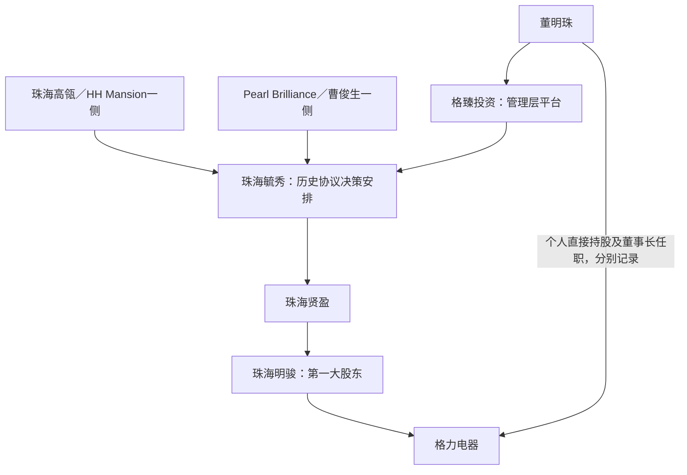

# 格力电器关键人物背景与控制关系调查分析报告

**主体：**珠海格力电器股份有限公司（000651.SZ）  
**主要观察期：**2023—2025年度及2026年上半年，角色截面截至2026-06-30  
**资料检索截止：**2026-10-17；为解释组织形成、混改和接班向前追溯  
**性质：**公开资料研究。正式控制权认定、交易方说明及研究解释分别处理，不以人物知名度推断控制权。

## 一、调查摘要

格力的人物调查必须从“无控股股东、无实际控制人”的正式披露出发。董明珠是长期经营与品牌核心、第一大股东珠海明骏的一致行动人；上述影响力不能直接写成其为上市公司实控人。高瓴创始人张磊、管理层平台、经销商股东与董事会也属于不同层次。2025年报及2026年中报继续披露无实际控制人/控制身份未变。[G25，PDF第78—79页](https://static.cninfo.com.cn/finalpage/2026-04-29/1225250396.PDF#page=78)[G26，PDF第50页](https://static.cninfo.com.cn/finalpage/2026-08-27/1225515004.PDF#page=50)[G26，PDF第75页](https://static.cninfo.com.cn/finalpage/2026-08-27/1225515004.PDF#page=75)

主要发现：

1. **2025年出现明确的董事长与总裁分工调整。** 董明珠于4月22日卸任总裁，继续任董事长；张伟接任总裁。2026年方祥建任常务副总裁。必须分清接班职位与全面退休。[G25，PDF第42—46页](https://static.cninfo.com.cn/finalpage/2026-04-29/1225250396.PDF#page=42)
2. **张伟的背景横跨工厂、供应链、企业管理和原股东集团。** 其不是仅凭“年轻高管”标签即可解释的空降接班者；1999年入职、2013—2020年任格力集团副总裁以及上市公司董事等经历具有连续性。[G23，PDF第45页](https://static.cninfo.com.cn/finalpage/2024-04-30/1219928418.PDF#page=45)[G25，PDF第44页](https://static.cninfo.com.cn/finalpage/2026-04-29/1225250396.PDF#page=44)
3. **董明珠的影响力来自多种渠道。** 销售及长期经营经历、董事长职位、个人持股、平台和提名安排共同构成其作用，单一直接持股比例无法完整描述。各渠道又不能简单叠加为个人控制比例。[G20，PDF第1—4页](https://static.cninfo.com.cn/finalpage/2020-01-18/1207264600.PDF#page=1)[G20，PDF第10—13页](https://static.cninfo.com.cn/finalpage/2020-01-18/1207264600.PDF#page=10)[G25，PDF第47页](https://static.cninfo.com.cn/finalpage/2026-04-29/1225250396.PDF#page=47)[G26，PDF第48—50页](https://static.cninfo.com.cn/finalpage/2026-08-27/1225515004.PDF#page=48)
4. **技术和质量人员进入高管层值得关注。** 2025年刘华、李绍斌、胡余生等获聘副总裁，与此前庄培、谭建明退休形成团队更新；王凯则有警务等不同职业背景。不能将整个团队概括为同一种技术出身。[G24，PDF第50页](https://static.cninfo.com.cn/finalpage/2025-04-28/1223330631.PDF#page=50)[G25，PDF第44—46页](https://static.cninfo.com.cn/finalpage/2026-04-29/1225250396.PDF#page=44)
5. **重要股东的数量变化和管理层利益变化有不同来源。** 明骏2026H1实际减持已有正式交易公告；董明珠持股增加需结合员工持股归属与具体公告，不能仅从快照推断是二级市场买入。[G-W5](https://disc.static.szse.cn/disc/disk03/finalpage/2026-06-05/050c8c21-137f-4646-880d-2bfe43fd529a.PDF)[G26，PDF第34—35页](https://static.cninfo.com.cn/finalpage/2026-08-27/1225515004.PDF#page=34)[G26，PDF第48—50页](https://static.cninfo.com.cn/finalpage/2026-08-27/1225515004.PDF#page=48)

## 二、人物范围与四期截面

| 调查层次 | 人物 | 研究意义 |
| --- | --- | --- |
| 经营、品牌及平台核心 | 董明珠 | 销售成长、长期管理、董事长职责、个人与平台利益 |
| 接班与执行核心 | 张伟、方祥建 | 工厂/供应链/质量背景、总裁和常务副总裁职责形成 |
| 历史组织形成 | 朱江洪 | 技术与质量传统、早期经营及2012年交接 |
| 重要投资方背景 | 张磊、曹俊生及公告列明的决策相关人 | 资本平台、混改与治理机制，不能自动认作实控人 |
| 股东与董事接口 | 张军督、郭书战、舒立志 | 经销商、原股东/专业监督与管理层的关系 |
| 技术与功能高管 | 刘华、李绍斌、胡余生、王凯、廖建雄、章周虎 | 技术、法务/安全类经历、财务、资本市场与职责分工 |
| 期间离任人员 | 庄培、谭建明、邓晓博、钟成堡等 | 技术代际、岗位调整及任期变动 |

实际控制人不是从上表中挑一位填写。人物范围由四期任职、持股及正式交易关系确定，不因某人未进入前十大流通股东就排除。[G23，PDF第45—47页](https://static.cninfo.com.cn/finalpage/2024-04-30/1219928418.PDF#page=45)[G24，PDF第50—52页](https://static.cninfo.com.cn/finalpage/2025-04-28/1223330631.PDF#page=50)[G25，PDF第42—47页](https://static.cninfo.com.cn/finalpage/2026-04-29/1225250396.PDF#page=42)[G26，PDF第34页](https://static.cninfo.com.cn/finalpage/2026-08-27/1225515004.PDF#page=34)

| 事项 | 2023年末 | 2024年末 | 2025年末 | 2026年6月末 |
| --- | --- | --- | --- | --- |
| 控股股东／实际控制人 | 无／无 | 无／无 | 无／无 | 未变更，财报继续说明无实控人 |
| 董明珠 | 董事长兼总裁 | 董事长兼总裁 | 董事长；4月卸任总裁 | 董事长 |
| 张伟 | 董事、党委书记 | 董事、党委书记 | 董事、总裁；党委书记职责后由舒立志承担 | 董事、总裁 |
| 方祥建 | 副总裁 | 副总裁 | 副总裁 | 2026-01-06起常务副总裁 |
| 董秘 | 邓晓博 | 邓晓博 | 章周虎，2025-01-10接任 | 章周虎 |
| 关键技术人员 | 谭建明等在任 | 庄培、谭建明当年退休 | 新技术高管任命 | 钟成堡6月18日离任董事 |

依据任职表、变动表及控制章节。2024年报叙述已包含2025年换届后“现任”情况，因此表中严格依生效日期还原，不将2025年总裁任命提前到2024年末。钟成堡离任董事也不自动等于离开全部技术职务。[G23，PDF第45—47页](https://static.cninfo.com.cn/finalpage/2024-04-30/1219928418.PDF#page=45)[G24，PDF第50—52页](https://static.cninfo.com.cn/finalpage/2025-04-28/1223330631.PDF#page=50)[G25，PDF第42—46页](https://static.cninfo.com.cn/finalpage/2026-04-29/1225250396.PDF#page=42)[G26，PDF第34页](https://static.cninfo.com.cn/finalpage/2026-08-27/1225515004.PDF#page=34)[G26，PDF第50页](https://static.cninfo.com.cn/finalpage/2026-08-27/1225515004.PDF#page=50)

2023、2024年两期“无控股股东、无实际控制人”也逐一核对原文，没有从2025年结论直接倒推。[G23，PDF第105页](https://static.cninfo.com.cn/finalpage/2024-04-30/1219928418.PDF#page=105)[G24，PDF第102页](https://static.cninfo.com.cn/finalpage/2025-04-28/1223330631.PDF#page=102)

## 三、控制关系：把投资、管理与表决权拆开

### 3.1 第一大股东为何不等于控制人

2025年报解释，2019年格力集团与珠海明骏签署15%股份转让协议后，明骏与一致行动人董明珠依可支配股份表决权和董事选任能力，未形成公司所认定的控制。因此四期研究应继续使用正式披露，而不是用“强势董事长”“高瓴入主”等媒体表达替代控制结论。[G25，PDF第78页](https://static.cninfo.com.cn/finalpage/2026-04-29/1225250396.PDF#page=78)

2020年问询回复提供了理解该制度的原始资料：明骏经贤盈、毓秀等决策链运作，毓秀的有关决策由投资方与管理层平台形成多方安排；管理层平台在董事提名上有特定影响，但这种权利不等于拥有所有事项的单独决定权。历史协议的具体权利，仍须与本期是否修订的披露衔接，不能无条件当成永久安排。[G20，PDF第1—4页](https://static.cninfo.com.cn/finalpage/2020-01-18/1207264600.PDF#page=1)[G20，PDF第8—13页](https://static.cninfo.com.cn/finalpage/2020-01-18/1207264600.PDF#page=8)

图中上层关系来自2020年问询回复的交易历史，并非本报告重新认定的2026年最终自然人股权图；比例、决策权、合伙利益和任职没有混为一种箭头。[G20，PDF第1—4页](https://static.cninfo.com.cn/finalpage/2020-01-18/1207264600.PDF#page=1)[G20，PDF第6—8页](https://static.cninfo.com.cn/finalpage/2020-01-18/1207264600.PDF#page=6)

### 3.2 两项容易误读的关系

**一致行动认定与共同签订协议不同。** 原回复说明了相关一致行动认定，也保留交易方关于未另行签署一致行动协议的声明。后续年报明确将明骏与董明珠列为一致行动人；不能因没有某份同名协议就否认披露的关系。[G20，PDF第2—4页](https://static.cninfo.com.cn/finalpage/2020-01-18/1207264600.PDF#page=2)[G25，PDF第76页](https://static.cninfo.com.cn/finalpage/2026-04-29/1225250396.PDF#page=76)

**管理层平台不是所有经理人的统一表决权池。** 回复对其他17名平台出资人的有限合伙地位及其直接持有上市公司股份另作说明，不能把他们所有个人股票都当成董明珠可支配的票数。对高瓴不同法律实体与基金也需分开，机构品牌不自动构成全部账户的一致行动。[G20，PDF第4—6页](https://static.cninfo.com.cn/finalpage/2020-01-18/1207264600.PDF#page=4)

## 四、董明珠：销售型职业路径、长期经营与多层利益联系

### 4.1 教育与职业成长

公司年报披露其为硕士研究生学历；中南财经政法大学校友资料列其为2008级EMBA。AACSB历史人物资料提供了1990年从空调销售进入公司、1994年负责销售、2001年进入最高经营岗位、2012年任董事长的路径。教育进修发生在多年职业实践之后，不应把其写成进入公司时即具有相同学历。[G25，PDF第44页](https://static.cninfo.com.cn/finalpage/2026-04-29/1225250396.PDF#page=44)[G-W1](https://xypt.zuel.edu.cn/xyh/article/6978)[G-W2](https://www.aacsb.edu/about-us/advocacy/member-spotlight/influential-leaders/2015/dong-mingzhu)

| 时间 | 可核实经历 | 证据和说明 |
| --- | --- | --- |
| 1990年 | 进入格力前身相关空调销售业务 | AACSB人物资料 |
| 1994年 | 进入销售负责人岗位 | 历史人物资料；具体中文职衔以各期公告为准 |
| 2001年4月起 | 总裁任期可由年报任职表追溯 | 不以海外资料将general manager/president机械等同所有中文历史职衔 |
| 2008级 | 中南财经政法大学EMBA | 校方名单，未把入学年份作为授予年份 |
| 2012年5月起 | 董事长 | 年报任职表 |
| 2019年起 | 任格臻投资执行事务合伙人 | 年报外部任职表 |
| 2025-04-22 | 继续任董事长，卸任总裁 | 换届任职与变动表 |

来源：校方、AACSB及原始年报。早期副总经理等职衔的英文报道存在概括，未凭单篇报道填满所有晋升年月。[G-W1](https://xypt.zuel.edu.cn/xyh/article/6978)[G-W2](https://www.aacsb.edu/about-us/advocacy/member-spotlight/influential-leaders/2015/dong-mingzhu)[G25，PDF第42—47页](https://static.cninfo.com.cn/finalpage/2026-04-29/1225250396.PDF#page=42)

### 4.2 影响力从何而来

**正式职责。** 董事长职位、长期经营经验和对外代表角色有明确文件依据。2026年中报的“董明珠健康家”等渠道品牌说明个人名字已进入公司营销体系，但不能以这一事实证明所有经营决策均由其个人作出。[G25，PDF第44页](https://static.cninfo.com.cn/finalpage/2026-04-29/1225250396.PDF#page=44)[G26，PDF第13—14页](https://static.cninfo.com.cn/finalpage/2026-08-27/1225515004.PDF#page=13)

**经济利益。** 个人直接持股从2023年末54,488,492股增至2024年末100,798,492股，2025年末不变，2026年6月末为112,486,665股；其平台权益又是不同层级的投资。不能把其在格臻的出资比例乘上明骏全部持仓就直接宣布为其个人持有上市公司股份。[G23，PDF第101页](https://static.cninfo.com.cn/finalpage/2024-04-30/1219928418.PDF#page=101)[G24，PDF第98页](https://static.cninfo.com.cn/finalpage/2025-04-28/1223330631.PDF#page=98)[G25，PDF第75页](https://static.cninfo.com.cn/finalpage/2026-04-29/1225250396.PDF#page=75)[G26，PDF第48—50页](https://static.cninfo.com.cn/finalpage/2026-08-27/1225515004.PDF#page=48)[G20，PDF第1—4页](https://static.cninfo.com.cn/finalpage/2020-01-18/1207264600.PDF#page=1)

**治理关系。** 与第一大股东的一致行动关系及历史董事提名安排增强其影响的制度解释力；不过正式披露仍是无实控人。把经营影响、声望、经济利益和控制认定分开，才能解释看似“持股不多但影响较大”的现象，而不诉诸隐秘关系猜测。

### 4.3 关键事件：总裁交接与个人角色延续

2025年4月22日张伟接任总裁，是本轮人物调查中最重要的人事节点之一。**分析：**董事长保留与总裁分设，可解释为经营责任分工调整和内部接班的推进；现有文件没有证明董明珠完全退休，也没有证明张伟独立掌握全部战略决策。观察重点应是董事会、总裁、常务副总裁和业务高管的职责如何落实，而非仅从年龄或舆论标签推测权力转移。[G25，PDF第42—46页](https://static.cninfo.com.cn/finalpage/2026-04-29/1225250396.PDF#page=42)

### 4.4 跨业务利益与监管事项的处理

格力钛相关事件与多元化背景值得保留，但必须区分公司陈述和个人责任。2025年报披露格力钛子公司股权被司法冻结，并将原因追溯至其前身原控制人相关担保和仲裁事项。本文不据此把原控制人行为、仲裁责任或全部投资损失归为董明珠个人违法，也不从当年个人观点直接推断法律责任。[G25，PDF第71页](https://static.cninfo.com.cn/finalpage/2026-04-29/1225250396.PDF#page=71)

年报“近三年证券监管处罚”栏为不适用，说明的是该报告范围。未对所有人物、所有时期、所有法域作穷尽司法检索，不作“无争议”“无不良记录”的结论。[G25，PDF第47页](https://static.cninfo.com.cn/finalpage/2026-04-29/1225250396.PDF#page=47)

## 五、张伟：从制造和供应链岗位到总裁

### 5.1 履历与专业背景

年报披露其为本科、正高级经济师，1999年加入格力；经历管路分厂、物资供应、外协外购质量、企业管理及总裁助理。2013—2020年任珠海格力集团副总裁，2019年起任上市公司董事，2020年起担任上市公司党委书记，2025年4月接任总裁。2025年5月党委书记职务由舒立志承担，不能将旧简历中的“兼党委书记”一直沿用到期末。[G23，PDF第45页](https://static.cninfo.com.cn/finalpage/2024-04-30/1219928418.PDF#page=45)[G24，PDF第50页](https://static.cninfo.com.cn/finalpage/2025-04-28/1223330631.PDF#page=50)[G25，PDF第42—45页](https://static.cninfo.com.cn/finalpage/2026-04-29/1225250396.PDF#page=42)

| 时间 | 经历 | 对接班的解释价值 |
| --- | --- | --- |
| 1999年 | 入职格力 | 长期内部经验，不是2025年首次进入企业 |
| 此后 | 工厂、供应、质量及企业管理 | 与生产运营及组织协调直接相关 |
| 2013—2020年 | 格力集团副总裁 | 有股东集团和不同组织层面的经历 |
| 2019年起 | 上市公司董事 | 总裁任命前已有治理层任职 |
| 2025-04-22 | 上市公司总裁 | 明确的经营岗位接班 |

**教育缺项。** 本轮取得的正式简历只明确本科及职称，未核实其本科院校、专业和授予年份；不同网站对同名“张伟”的学校信息不能直接合并。上述未知不妨碍确认其职业岗位，但限制了教育背景的细化程度。

### 5.2 接班机制分析

其供应链和制造经历与董明珠的销售成长路径形成差异；这可以解释新管理组合具备不同经验来源，不能直接证明战略由营销转为技术，也不能证明两者关系发生对立。

2026年中报列其直接持股由483,328股增至558,328股。数量变化是已披露事实，取得方式需结合激励和具体公告，不能因为总裁任命便推断股票是任命奖励。[G26，PDF第50页](https://static.cninfo.com.cn/finalpage/2026-08-27/1225515004.PDF#page=50)

## 六、方祥建：质量与制造体系的内部晋升

年报列其为硕士、正高级工程师。2001年起在筛选分厂工作，后历任厂长、质量控制部负责人、助理总裁，2021年任副总裁，2026-01-06起任常务副总裁。其教育院校在已核对年报简历中未展开，不据第三方资料代替确认。[G23，PDF第47页](https://static.cninfo.com.cn/finalpage/2024-04-30/1219928418.PDF#page=47)[G25，PDF第45—46页](https://static.cninfo.com.cn/finalpage/2026-04-29/1225250396.PDF#page=45)

| 阶段 | 职业路径 | 可作的有限解释 |
| --- | --- | --- |
| 2001—2016年 | 分厂、制造及质量岗位 | 对工艺和质量体系具实际经历 |
| 2016年起 | 助理总裁 | 从职能向公司管理延伸 |
| 2021年起 | 副总裁 | 高管层正式任职 |
| 2026年1月起 | 常务副总裁 | 执行管理职责扩大，不能等同于总裁或董事长接班已定 |

**分析。** 与张伟的制造/供应背景、技术高管的产品研究背景相配合，方祥建提供质量和生产执行经验。其角色值得从质量体系与跨部门执行来解释，不宜只按持股多少排列影响力。2026年中报列其直接持股829,290股，数量与岗位关系不能自动解释为因果。[G26，PDF第50页](https://static.cninfo.com.cn/finalpage/2026-08-27/1225515004.PDF#page=50)

## 七、朱江洪：技术、质量传统与历史交接

华南理工大学校友会2014年人物材料记载其1970年毕业于华南工学院机械系，在广西百色矿山机械厂从工人、技术岗位成长为厂长，1988年回珠海；2001年4月至2012年5月任格力电器董事长。原人物材料已归档，所述角色属于历史背景，不列为2023—2026H1在任高管。[G-Z，PDF第1—2页](https://alumni.scut.edu.cn/_upload/article/files/f3/9e/cd1c0bc34632874dc13b2ae20853/2b5c2b90-a370-4c60-a542-55ef17975823.pdf#page=1)

其成长经历有机械制造和工厂管理的连续性，与后来的质量、技术传统具有可解释联系。**分析：**这使格力的技术和组织积累不宜全部归因于后来某一任负责人；同时，也不能把早期创始人称谓推导为其在本期仍拥有个人控制权。

关于朱江洪与董明珠，已取得的文件能够确认不同阶段的经营与董事长交接。公众回忆、人物评价和媒体叙事不能替代正式任职，更不能据此判断私人冲突。本文保留组织传承的证据，未采纳未经核实的两人私人关系故事。

## 八、重要投资方人物：张磊、曹俊生及其他决策相关人

### 8.1 张磊：投资机构创始人的背景与法律实体边界

耶鲁商学院历史访谈记载张磊为2002届校友，毕业后创办高瓴并得到耶鲁捐赠基金的早期支持；Milken活动资料所载本人提供的简介列其人大经济学、耶鲁MBA和硕士背景，该机构明确说明未独立核验嘉宾简历。其职业路径是投资机构创建和资本配置，与经营制造企业的总裁路径不同。[G-W3](https://insights.som.yale.edu/insights/how-do-you-invest-in-changing-china)[G-W4](https://milkeninstitute.org/events/asia-summit-2024/speakers/lei-zhang)

**关系边界。** 原问询回复特别说明高瓴是多个管理、顾问机构使用的品牌，并非一个单一法律主体；交易决策链须落实到具体平台和有关合伙人。因此本文把张磊列作理解重要投资机构的背景人物，**不将其写为格力实控人，不将其个人名字替代全部基金和平台**。[G20，PDF第5—6页](https://static.cninfo.com.cn/finalpage/2020-01-18/1207264600.PDF#page=5)

**分析。** 资本方的期限、融资与退出约束可能影响上市公司持仓决策；不能仅用创始人公开宣扬的投资理念解释每一次交易。2026年实际减持应以公告和融资事项为证据，不从一篇人物访谈推断其个人态度变化。

### 8.2 曹俊生：混改与投资经验带来的治理参与

2020年问询回复根据交易方提供材料，说明曹俊生及懋源投资具有私募投资、国企改制等经历，并解释由高瓴引入本交易、相关主体参与毓秀治理。该文件也记录其关系声明；这属于发行人向交易方核实后的正式回复，而非本报告独立访问其本人或认证全部历史项目。[G20，PDF第6—8页](https://static.cninfo.com.cn/finalpage/2020-01-18/1207264600.PDF#page=6)

**分析。** 他的调查意义在于说明第一大股东内部还有不同投资方与决策安排，不能用“高瓴一方”概括全部股东权能。已取得文件未完整披露教育和早期职业时间线，本报告不从同名工商记录拼接，也不将其说成董明珠的代持人。

### 8.3 其他自然人为何只作有边界的关系记录

历史回复列出马翠芳、李良、曹伟及YI QINGQING等的高瓴相关任职与决策关系。本文据此在关系台账保留这些姓名、主体及历史日期，不把机构合伙人身份直接转化为上市公司实控人身份。当前职务及全部教育、职业经历未取得足够资料，不以“调查了张磊”冒充已穿透所有交易参与者。[G20，PDF第1页](https://static.cninfo.com.cn/finalpage/2020-01-18/1207264600.PDF#page=1)[G20，PDF第6页](https://static.cninfo.com.cn/finalpage/2020-01-18/1207264600.PDF#page=6)

## 九、张军督、郭书战与舒立志：渠道及治理接口

### 9.1 张军督：经销商网络与上市公司董事

年报列其大专学历，1999年起任浙江通诚格力董事长，2012年起任上市公司董事，并在浙江销售实体和京海互联网任职。其职业背景与销售渠道组织相关，属于理解厂商关系和渠道股东参与的重要人物。[G23，PDF第45页](https://static.cninfo.com.cn/finalpage/2024-04-30/1219928418.PDF#page=45)[G25，PDF第45页](https://static.cninfo.com.cn/finalpage/2026-04-29/1225250396.PDF#page=45)[G25，PDF第47页](https://static.cninfo.com.cn/finalpage/2026-04-29/1225250396.PDF#page=47)

**分析。** 经销商或渠道背景进入董事会，可提供市场与渠道经验，也需要对关联交易、渠道资源和上市公司利益边界进行制度监督。不能因兼任就断言存在利益输送，也不能忽略其相对于普通外部董事的业务联系。其个人具体学校和更早经历未在已取得材料中确认。

### 9.2 郭书战：期间在任的经销商股东代表性人物

2023年报列其为专科学历、京海互联网董事长兼总经理，并在河南地区销售实体任职；其2019年进入上市公司董事会，2025年4月任满离任。不能因2025年最新董事名单不含其人，就漏掉前两年的治理角色。[G23，PDF第45页](https://static.cninfo.com.cn/finalpage/2024-04-30/1219928418.PDF#page=45)[G23，PDF第47页](https://static.cninfo.com.cn/finalpage/2024-04-30/1219928418.PDF#page=47)[G25，PDF第42—44页](https://static.cninfo.com.cn/finalpage/2026-04-29/1225250396.PDF#page=42)

**分析。** 与张军督一同观察，可见渠道主体在历史治理中的参与方式和变化；其离任不能自动解释为经销商全部退出股东体系。京海2025年持仓反而上升，说明人物席位和法人持股要分别研究。

### 9.3 舒立志：外部审计经验进入公司管理

年报披露其硕士研究生学历，曾任国家审计署武汉特派办有关处级岗位，2019年12月加入，2020年12月起任副总裁；2025年4月进入董事会、离任副总裁，5月起任党委书记。[G23，PDF第47页](https://static.cninfo.com.cn/finalpage/2024-04-30/1219928418.PDF#page=47)[G25，PDF第42—45页](https://static.cninfo.com.cn/finalpage/2026-04-29/1225250396.PDF#page=42)

**分析。** 其外部监督和审计经历可解释专业知识来源，不能自动推断其个人承接了监管机构权力，也不能从党内职务直接认定其拥有个人股权控制。其当前董事、党委书记与过去副总裁身份须按日期区分；未取得明确职权文本的具体业务分工不猜测。

## 十、技术、财务与其他高管

| 人物 | 可确认教育与职业背景 | 任职变化与调查分析 | 证据 |
| --- | --- | --- | --- |
| 刘华 | 博士、教授级高级工程师；2003年进入商用空调设计，后任部门负责人、总裁助理及副总工程师 | 2025年任副总裁，反映商用技术人员进入经营层；具体院校/学位年份未核实 | [G25，PDF第46页](https://static.cninfo.com.cn/finalpage/2026-04-29/1225250396.PDF#page=46) |
| 李绍斌 | 硕士、正高级工程师；商用设计开发、总工程师助理经历 | 2025年任副总裁；技术经验有岗位依据，不能由职称断言所有研发成果均为其个人贡献 | [G25，PDF第46页](https://static.cninfo.com.cn/finalpage/2026-04-29/1225250396.PDF#page=46) |
| 胡余生 | 哈尔滨工业大学背景、博士、教授级高级工程师；2004年加入，历经制冷/机电研究及总工程师助理 | 2025年任副总裁，是研究体系进入高管层的另一条路径；具体各阶段学位年份未展开 | [G25，PDF第46页](https://static.cninfo.com.cn/finalpage/2026-04-29/1225250396.PDF#page=46) |
| 王凯 | 中国刑事警察学院背景、硕士；曾任深圳公安相关岗位 | 2019年任总裁助理，2025年副总裁；外部警务经历不能自动映射为未披露的公司法务或某项业务分工 | [G25，PDF第46页](https://static.cninfo.com.cn/finalpage/2026-04-29/1225250396.PDF#page=46) |
| 廖建雄 | 本科；1993年5月加入，重庆公司及上市公司财务部门经历 | 2020年起财务负责人、总裁助理，长期内部财务路径；院校和会计资格细项未完整确认 | [G23，PDF第47页](https://static.cninfo.com.cn/finalpage/2024-04-30/1219928418.PDF#page=47)[G25，PDF第46页](https://static.cninfo.com.cn/finalpage/2026-04-29/1225250396.PDF#page=46) |
| 章周虎 | 本科；2007年入职，芜湖/合肥财务、证券事务和投资管理，曾任盾安环境副总裁、董秘 | 2025-01-10接任集团董秘，体现财务、资本市场与子公司治理交叉经历；不推断其控制盾安 | [G25，PDF第44页](https://static.cninfo.com.cn/finalpage/2026-04-29/1225250396.PDF#page=44)[G25，PDF第46页](https://static.cninfo.com.cn/finalpage/2026-04-29/1225250396.PDF#page=46) |
| 邓晓博 | 本科，2020年起副总裁、董秘，2022年进入董事会 | 2025年1月离任董秘、4月离任董事/副总裁；分开记事。更早职业和教育细节未取得充分原始资料 | [G23，PDF第45页](https://static.cninfo.com.cn/finalpage/2024-04-30/1219928418.PDF#page=45)[G25，PDF第42—44页](https://static.cninfo.com.cn/finalpage/2026-04-29/1225250396.PDF#page=42) |
| 庄培 | 本科、高级工程师，2002—2003年总裁助理，此后副总裁 | 2024-07-06退休；与新技术高管形成时间上可观察的更新，不据此认定具体一对一接班关系 | [G23，PDF第46页](https://static.cninfo.com.cn/finalpage/2024-04-30/1219928418.PDF#page=46)[G24，PDF第50页](https://static.cninfo.com.cn/finalpage/2025-04-28/1223330631.PDF#page=50) |
| 谭建明 | 华中科技大学制冷与低温学士（1986）、硕士（1989）；1989年加入 | 长期技术负责人，2024-12-24退休；技术传统的重要历史人物 | [G23，PDF第46—47页](https://static.cninfo.com.cn/finalpage/2024-04-30/1219928418.PDF#page=46)[G24，PDF第50页](https://static.cninfo.com.cn/finalpage/2025-04-28/1223330631.PDF#page=50) |
| 钟成堡 | 哈工大机械相关学士（2008）、北京理工大学计算机硕士（2024）；2008年入职、研究院管理 | 2025年任董事；2026-06-18工作调整离任董事。不能写成2026年全面退出研发体系 | [G25，PDF第45页](https://static.cninfo.com.cn/finalpage/2026-04-29/1225250396.PDF#page=45)[G26，PDF第34页](https://static.cninfo.com.cn/finalpage/2026-08-27/1225515004.PDF#page=34) |
| 邵丽国 | 硕士、高级工程师；生产、分厂、合肥公司、设备及企业管理经历 | 2025年先任职工监事、后转职工董事；属于员工与运营背景进入治理层 | [G25，PDF第42页](https://static.cninfo.com.cn/finalpage/2026-04-29/1225250396.PDF#page=42)[G25，PDF第45页](https://static.cninfo.com.cn/finalpage/2026-04-29/1225250396.PDF#page=45) |

**团队分析。** 2024年老技术高管退休、2025年多位技术及功能人员进入副总裁层，2026年再出现常务副总裁任命，提供了团队调整的明确时间线。其效果不能仅以任命数量衡量，应观察职责交接、研发和质量系统的连续性，以及总裁与常务副总裁之间的执行分工。

独立董事监督背景另包括张秋生的财务并购研究、程明的电机研究、李红旗的制冷研究、翁国民的法律研究；2025年刘姝威、邢子文、王晓华等任满离任。这里记录的是专业配置与正式职务，不从学术身份直接证明独立性或实际履职效果。[G23，PDF第45—46页](https://static.cninfo.com.cn/finalpage/2024-04-30/1219928418.PDF#page=45)[G25，PDF第44—47页](https://static.cninfo.com.cn/finalpage/2026-04-29/1225250396.PDF#page=44)

## 十一、辅助：重要持仓与前十大流通股东变化

### 11.1 与人物有关的四期矩阵

| 主体/口径（股） | 2023年末 | 2024年末 | 2025年末 | 2026年6月末 |
| --- | ---: | ---: | ---: | ---: |
| 珠海明骏：无限售持股 | 902,359,632 | 902,359,632 | 902,359,632 | 859,566,532 |
| 京海互联网：无限售持股 | 386,043,038 | 392,442,954 | 438,825,662 | 438,825,662 |
| 董明珠：总持股 | 54,488,492 | 100,798,492 | 100,798,492 | 112,486,665 |
| 董明珠：其中无限售股份 | 13,622,123 | 25,199,623 | 25,199,623 | 28,121,666 |

来源：两类股东表及任职持股表。董明珠的无限售股份从总持股表的对应列取得，并非声称其每期均进入前十名无限售名单。年报比例与剔除回购口径可能不同，表内未把它们混用。[G23，PDF第101—102页](https://static.cninfo.com.cn/finalpage/2024-04-30/1219928418.PDF#page=101)[G24，PDF第98—99页](https://static.cninfo.com.cn/finalpage/2025-04-28/1223330631.PDF#page=98)[G25，PDF第75—76页](https://static.cninfo.com.cn/finalpage/2026-04-29/1225250396.PDF#page=75)[G26，PDF第48—50页](https://static.cninfo.com.cn/finalpage/2026-08-27/1225515004.PDF#page=48)

### 11.2 三个区间的解释

- **2023→2024年末：**明骏数量不变，披露比例16.02%变为16.11%，不能写成增持；京海数量增加6,399,916股。董明珠总持股增加46,310,000股，这是快照及原文变动字段事实，取得方式须查相应计划、归属与交易，不能全部称作市场买入。[G23，PDF第101页](https://static.cninfo.com.cn/finalpage/2024-04-30/1219928418.PDF#page=101)[G24，PDF第98页](https://static.cninfo.com.cn/finalpage/2025-04-28/1223330631.PDF#page=98)
- **2024→2025年末：**明骏、董明珠总股数未变；京海增加46,382,708股，2025年报另说明京海通过增持专项贷款和集中竞价方式实施增持，因此这一项有较明确的交易与融资依据。不能据渠道股东增持就认定其控制上市公司。[G25，PDF第71页](https://static.cninfo.com.cn/finalpage/2026-04-29/1225250396.PDF#page=71)[G25，PDF第75页](https://static.cninfo.com.cn/finalpage/2026-04-29/1225250396.PDF#page=75)
- **2025年末→2026年6月末：**明骏减少42,793,100股；2026-06-05《关于持股5%以上股东权益变动比例触及1%整数倍的公告》确认6月4日大宗交易的实施，区别于仅有预减持计划。董明珠总持股增加11,688,173股；中报另披露员工持股归属，但未将其个人全部增量逐笔关联，本文保留取得方式待核实。京海数量不变。[G-W5，PDF第1页](https://disc.static.szse.cn/disc/disk03/finalpage/2026-06-05/050c8c21-137f-4646-880d-2bfe43fd529a.PDF#page=1)[G26，PDF第34—35页](https://static.cninfo.com.cn/finalpage/2026-08-27/1225515004.PDF#page=34)[G26，PDF第48—50页](https://static.cninfo.com.cn/finalpage/2026-08-27/1225515004.PDF#page=48)

明骏融资、解除质押和减持与投资平台资金约束相关，是值得观察的治理背景；2026年7月《关于持股5%以上股东股份补充质押的公告》提到原减持的还贷用途，并披露未减持部分补充质押。该文件属于期后披露，仅用于解释已发生事项，未提前记作6月之后的新减持。不能将这些信息直接翻译成张磊个人“看空格力”或控制权已转移。[G-W6，PDF第1页](https://disc.static.szse.cn/disc/disk03/finalpage/2026-07-16/3d075d86-c210-46b2-bf64-0e751d9f72c6.PDF#page=1)[G26，PDF第50页](https://static.cninfo.com.cn/finalpage/2026-08-27/1225515004.PDF#page=50)

2025年报对明骏所持902,359,632股列示质押，并披露融资用途及公司当时的风险判断。这是应跟踪的股东融资条件，不能把“存在质押”直接等同于已发生平仓或控制权不稳定。[G25，PDF第75页](https://static.cninfo.com.cn/finalpage/2026-04-29/1225250396.PDF#page=75)[G25，PDF第79页](https://static.cninfo.com.cn/finalpage/2026-04-29/1225250396.PDF#page=79)

## 十二、综合分析与具体未决事项

### 12.1 关键人物背景给出的治理解释

**经营影响力有制度和职业基础。** 董明珠的销售/渠道经历、张伟的制造/供应经历、方祥建的质量经历，与技术及财务高管形成具体能力分工。企业的组织积累还包含朱江洪等历史管理者的贡献，不能把公司表现完全归为个人性格。

**接班已发生在具体岗位，尚不能推断全面交棒。** 总裁更换有明确日期，董事长保留与常务副总裁任命则体现进一步分工。这个结构可能降低个人执行负担，也可能需要新的协调机制；现有资料不足以确定最终权力平衡及长期接班安排。

**无实控人不等于没有强影响人物。** 管理层长期经验、平台权益及提名安排能增强影响；第一大股东和经销商主体仍有其经济与治理角色。分析应对每种权利单独取证，避免用一个“真正老板”的故事概括整个结构。

### 12.2 资料局限与后续复核

| 项目 | 已确认部分 | 未解决部分 |
| --- | --- | --- |
| 董明珠教育与职业早期 | 年报学历、校方EMBA班级、AACSB历史路径 | 各早期中文职衔完整原任命档案未全部取得 |
| 张伟、廖建雄等院校 | 学历和岗位经历 | 正式简历未展开的学校/专业不补写，避免同名误配 |
| 2020交易决策机制 | 原始问询回复、后续年报控制结论 | 未取得全部平台截至2026年的最新合伙协议，不认定历史条款永远不变 |
| 投资方人物全履历 | 张磊学校/机构资料、曹俊生交易背景 | 其他合伙人及曹俊生完整教育时间线不足 |
| 董明珠2024及2026持股增量 | 总股数、无限售部分和计划实施资料 | 尚未逐笔确认所有个人取得路径，不能全部归因市场买入 |
| 钟成堡后续职责 | 已确认离任董事 | 未用该事件推断其他岗位均终止 |
| 监管司法背景 | 年报限定范围披露、职业相关公开资料 | 非穷尽跨法域调查；子公司争议不自动变成人物个人责任 |

本报告不采集私人住址、身份证号或与职业/治理无关的家庭生活，不使用缺乏正式依据的派系、私人冲突和秘密控制叙事。期后披露与期末状态保持区分。

## 十三、来源与方法

采用四期原始财报、2020年原始问询回复、学校资料、历史人物和投资机构相关资料，逐项核对任职、生效日期、关系与持股。关键跨行任职表已回看PDF；股数差为简单两期相减，单位为股，快照缺失不填零。台账及具体限制见`personnel_research/`。

<!-- RESEARCH_SOURCE_INDEX_START -->

| 编号 | 来源及日期 | 原件/获取状态 |
| --- | --- | --- |
| G23 | [珠海格力电器股份有限公司2023年年度报告](https://static.cninfo.com.cn/finalpage/2024-04-30/1219928418.PDF)；发行人／官方披露渠道；2024-04-30 | [仓库原件](origin/年度报告/格力2023.pdf)；复用已归档全文；本轮阅读相应人物与控制章节 |
| G24 | [珠海格力电器股份有限公司2024年年度报告](https://static.cninfo.com.cn/finalpage/2025-04-28/1223330631.PDF)；发行人／官方披露渠道；2025-04-28 | [仓库原件](origin/年度报告/格力2024.pdf)；复用已归档全文；本轮阅读相应人物与控制章节 |
| G25 | [珠海格力电器股份有限公司2025年年度报告](https://static.cninfo.com.cn/finalpage/2026-04-29/1225250396.PDF)；发行人／官方披露渠道；2026-04-29 | [仓库原件](origin/年度报告/格力2025.pdf)；复用已归档全文；本轮阅读相应人物与控制章节 |
| G26 | [珠海格力电器股份有限公司2026年半年度报告](https://static.cninfo.com.cn/finalpage/2026-08-27/1225515004.PDF)；发行人／官方披露渠道；2026-08-27 | [仓库原件](origin/年度报告/格力2026半年度.pdf)；复用已归档全文；本轮阅读相应人物与控制章节 |
| G20 | [关于对深圳证券交易所问询函的回复说明（2020-001）](https://static.cninfo.com.cn/finalpage/2020-01-18/1207264600.PDF)；格力电器／巨潮资讯；2020-01-18 | [仓库原件](origin/人物调查/格力_20200118问询回复.pdf)；官方PDF已归档；历史协议及交易方声明与当前状态分开 |
| G-W5 | [关于持股5%以上股东权益变动比例触及1%整数倍的公告（2026-025）](https://disc.static.szse.cn/disc/disk03/finalpage/2026-06-05/050c8c21-137f-4646-880d-2bfe43fd529a.PDF)；格力电器／深圳证券交易所；2026-06-05 | [仓库原件](origin/人物调查/格力_20260605股东减持进展.pdf)；官方PDF已归档；研究期内实际交易 |
| G-W1 | [中南财经政法大学校友资料：董明珠2008级EMBA](https://xypt.zuel.edu.cn/xyh/article/6978)；中南财经政法大学校友会；页面未核定统一更新日 | 校方班级信息；不当作授予日期 |
| G-W2 | [Dong Mingzhu, 2015 Influential Leader](https://www.aacsb.edu/about-us/advocacy/member-spotlight/influential-leaders/2015/dong-mingzhu)；AACSB；2015人物资料 | 历史职业路径；中文具体职衔优先看发行人原文 |
| G-Z | [华工人物周刊第二期：朱江洪，格力创始人的传奇人生](https://alumni.scut.edu.cn/_upload/article/files/f3/9e/cd1c0bc34632874dc13b2ae20853/2b5c2b90-a370-4c60-a542-55ef17975823.pdf)；华南理工大学校友会；2014-04-29 | [仓库原件](origin/人物调查/格力_朱江洪华工人物周刊.pdf)；校方原始PDF已归档；历史人物资料 |
| G-W3 | [How Do You Invest in a Changing China?](https://insights.som.yale.edu/insights/how-do-you-invest-in-changing-china)；Yale Insights；2014-11-05 | 张磊历史访谈，不推定特定投资平台全部决策权 |
| G-W4 | [Lei Zhang, Asia Summit 2024 speaker biography](https://milkeninstitute.org/events/asia-summit-2024/speakers/lei-zhang)；Milken Institute；2024活动资料 | 嘉宾自行提供简介，Milken明确说明未独立验证；与耶鲁资料分层使用 |
| G-W6 | [关于持股5%以上股东股份补充质押的公告（2026-033）](https://disc.static.szse.cn/disc/disk03/finalpage/2026-07-16/3d075d86-c210-46b2-bf64-0e751d9f72c6.PDF)；格力电器／深圳证券交易所；2026-07-16 | [仓库原件](origin/人物调查/格力_20260716股东补充质押.pdf)；官方PDF已归档；期后披露，仅用于解释已发生事件 |

<!-- RESEARCH_SOURCE_INDEX_END -->

**交接：**本报告完成核心及相关人物档案、接班与控制机制分析、团队背景和股东变化附录；未公开、不可得或未能确认的细节保留在问题表，不替代人类研究者对最终结论的审阅。
