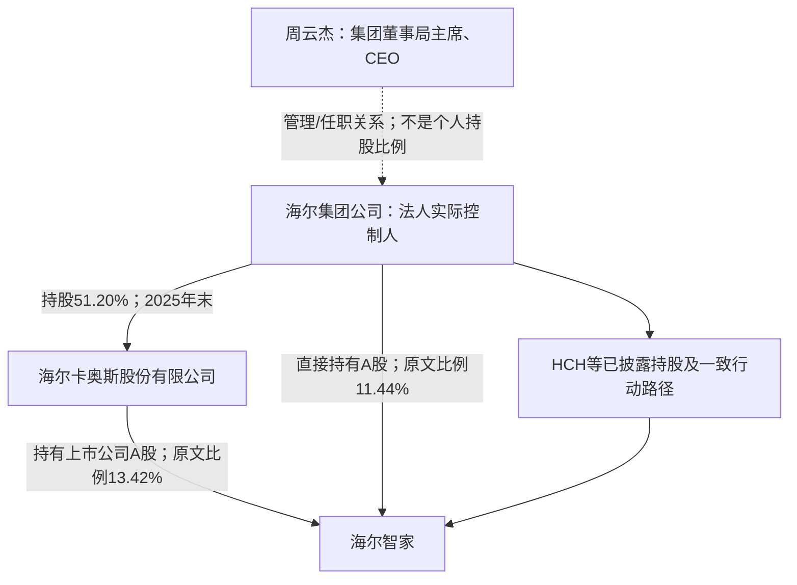

# 海尔智家关键人物背景与控制关系调查分析报告

**主体：**海尔智家股份有限公司（600690.SH／06690.HK／D股渠道）  
**主要观察期：**2023—2025年度及2026年上半年，角色截面截至2026-06-30  
**资料检索截止：**2026-10-17；人物教育、职业与接班历史向前追溯  
**性质：**公开资料研究。正式控制身份、公司自述和本报告分析分别标示；未核实的自然人控制关系不作推断。

## 一、调查摘要

海尔智家需要同时研究法人控制链、海尔集团决策层、上市公司经营层及海外经营团队。2025年报列明控股股东为海尔卡奥斯股份有限公司，实际控制人为**法人海尔集团公司**，并说明海尔集团的集体所有制性质。周云杰是集团董事局主席、CEO及有关法人的负责人，不能据这些职务直接改写为海尔智家的自然人实控人；张瑞敏的历史创始人与管理思想影响也不等同于个人股权控制。[H25，PDF第105—107页](https://static.cninfo.com.cn/finalpage/2026-03-27/1225038336.PDF#page=105)[H-W1](https://www.haier.com/about-haier/ceo/)

主要发现：

1. **海尔的接班包含集团与上市公司两个层次。** 2021年的集团接班安排涉及张瑞敏、周云杰、梁海山；主要研究期上市公司董事长、总裁为李华刚。集团董事局主席、集团总裁与上市公司总裁不是同一职务。[H-W2](https://www.haier.com/global/press-events/news/20211105_172777.shtml)[H23，PDF第53—55页](https://static.cninfo.com.cn/finalpage/2024-03-28/1219427279.PDF#page=53)[H25，PDF第64—66页](https://static.cninfo.com.cn/finalpage/2026-03-27/1225038336.PDF#page=64)
2. **李华刚与主要业务高管体现长期内部培养，海外团队又保留外部专业来源。** 李华刚由销售和中国区经营成长；Kevin Nolan则有GE工程、技术管理及美国本土经营经历。全球化能力由不同团队承担，不能归结为单一个人。[H25，PDF第66—70页](https://static.cninfo.com.cn/finalpage/2026-03-27/1225038336.PDF#page=66)[H-W6](https://geappliancesco.com/kevin-nolan/)[H-W7](https://engineering.uconn.edu/person/nolan-kevin-f/)
3. **2025年财务治理接口发生变化。** 宫伟由上市公司财务总监、副总裁进入副董事长及集团CFO角色，孙佳程进入上市公司CFO岗位；邵新智离开上市公司副董事长职位。该变化应分层、分日期解释，不能概括成财务人员集体退出。[H24，PDF第63—65页](https://static.cninfo.com.cn/finalpage/2025-03-28/1222926246.PDF#page=63)[H25，PDF第64—74页](https://static.cninfo.com.cn/finalpage/2026-03-27/1225038336.PDF#page=64)
4. **管理层持股和激励必须分辨股票、归属与期权注销。** 多名高管2025年持股增加的原文原因是员工持股计划归属；2026年中报某些负数则是注销期权而非交易减持。[H25，PDF第64—66页](https://static.cninfo.com.cn/finalpage/2026-03-27/1225038336.PDF#page=64)[H26，PDF第46页](https://static.cninfo.com.cn/finalpage/2026-08-28/1225522691.PDF#page=46)[H26，PDF第60页](https://static.cninfo.com.cn/finalpage/2026-08-28/1225522691.PDF#page=60)

## 二、对象范围与四期状态

### 2.1 调查分层

| 层次 | 人物 | 纳入依据 |
| --- | --- | --- |
| 集团历史与决策背景 | 张瑞敏、周云杰、梁海山 | 创始人、集团接班与职业经理人体系 |
| 集团专业平台背景 | 谭丽霞、邵新智 | 海外业务、财务共享及资本/治理历史；不预设为本期上市公司高管 |
| 上市公司经营与财务核心 | 李华刚、宫伟、孙佳程 | 董事长/总裁、集团与上市公司接口、财务接班 |
| 海外与数字化核心 | Kevin Nolan、孙丹凤 | 美国业务经营、数字化能力进入董事会 |
| 其他业务与功能高管 | 赵弇锋、李洋、宋玉军、管江勇、吴勇、黄晓武、刘晓梅、付松辉、黄德成、刘群 | 国内经营、产业、采购、海外、资本、法务与合规职责 |
| 期间离任人员 | 解居志、李攀等 | 期间职责与团队变动，保留历史背景 |

董事、监事及高管另行标注，不因董事会成员具有专业背景就将其写成经营高管。名单来自四期报告，其中2025年新增董事和高管的本期身份不能回填到2023年。[H23，PDF第53—58页](https://static.cninfo.com.cn/finalpage/2024-03-28/1219427279.PDF#page=53)[H24，PDF第63—68页](https://static.cninfo.com.cn/finalpage/2025-03-28/1222926246.PDF#page=63)[H25，PDF第64—74页](https://static.cninfo.com.cn/finalpage/2026-03-27/1225038336.PDF#page=64)

### 2.2 四期核心角色

| 事项 | 2023年末 | 2024年末 | 2025年末 | 2026年6月末 |
| --- | --- | --- | --- | --- |
| 控股股东／实际控制人 | 卡奥斯／海尔集团公司 | 同前 | 同前 | 中报披露未变更 |
| 李华刚 | 上市公司董事长、总裁 | 同前 | 换届后续任 | 未见中报披露该职务变化 |
| 宫伟 | 董事、财务总监、副总裁 | 同前 | 上市公司副董事长；集团CFO角色 | 承接上述已披露任职 |
| 上市公司财务核心 | 宫伟 | 宫伟 | 孙佳程，副总裁、CFO | 中报财务责任人等信息与前期衔接 |
| 邵新智 | 上市公司副董事长、集团CFO背景 | 同前 | 2025年5月换届离任上市公司副董事长 | 不列为在任上市公司副董事长 |
| 李攀 | 上市公司副总裁 | 同前 | 2025-12-30离任 | 不列为在任副总裁 |

来源：四期报告任职、变动和控制章节。2025年年报的任期表、股东单位任职表和简历可能采用不同观察时点；例如集团某项任职记为2026年开始，不能自动归入2025年末。中报并未重新给每位高管公布完整简历，“延续”依前期任命与本期变动披露衔接，不等于逐人重新核发任职证明。[H23，PDF第53—58页](https://static.cninfo.com.cn/finalpage/2024-03-28/1219427279.PDF#page=53)[H24，PDF第63—65页](https://static.cninfo.com.cn/finalpage/2025-03-28/1222926246.PDF#page=63)[H25，PDF第64—74页](https://static.cninfo.com.cn/finalpage/2026-03-27/1225038336.PDF#page=64)[H26，PDF第46页](https://static.cninfo.com.cn/finalpage/2026-08-28/1225522691.PDF#page=46)[H26，PDF第61页](https://static.cninfo.com.cn/finalpage/2026-08-28/1225522691.PDF#page=61)

历史控制身份另外核对2023年报和2024年报的正式控股股东、实际控制人章节，不以最新组织图替代此前两期认定。[H23，PDF第99—100页](https://static.cninfo.com.cn/finalpage/2024-03-28/1219427279.PDF#page=99)[H24，PDF第108—110页](https://static.cninfo.com.cn/finalpage/2025-03-28/1222926246.PDF#page=108)

## 三、先厘清控制关系：法人控制与人物影响

2025年报明确列海尔集团公司为实际控制人，控股股东海尔卡奥斯由海尔集团持股51.20%。年报控制图还列出集团直接持股、创业投资平台、HCH及D股持股平台等路径；集团及其一致行动平台的权益不能全部写到周云杰或张瑞敏个人名下。原控制图已回看PDF。[H25，PDF第104—107页](https://static.cninfo.com.cn/finalpage/2026-03-27/1225038336.PDF#page=104)

图中HCH等路径是概括节点，不表示集团对所有平台具有相同股权比例；具体边与类型见关系台账和原图。原图载明集团性质认定的历史依据，不能把“股份制登记”“集体所有制性质”“自然人所有”混为一谈。[H25，PDF第107页](https://static.cninfo.com.cn/finalpage/2026-03-27/1225038336.PDF#page=107)

**分析。** 在这一结构下，研究高管不能只找最大个人持股者。真正需要观察的是集团任命和监督接口、上市公司的经营授权、海外实体的本地管理以及激励机制。周云杰等人的影响来自正式职位、组织历练和集团治理安排，而非本报告能够证明的个人最终受益所有权。

## 四、张瑞敏：历史创始人与管理制度遗产

### 4.1 职业形成与教育

集团创始人简介记载其于1984年接任青岛电冰箱总厂厂长，1995年获中国科学技术大学工商管理硕士，后来提出人单合一等管理理念。2021年正式接班公告说明其不再参加新一届董事提名，受邀为董事局名誉主席；这些是不同于2023—2026H1上市公司日常管理职务的历史角色。[H-W3](https://www.haier.com/about-haier/founder/)[H-W2](https://www.haier.com/global/press-events/news/20211105_172777.shtml)

| 时点 | 已核实的角色或事件 | 人物调查意义 |
| --- | --- | --- |
| 1984年 | 出任青岛电冰箱总厂厂长 | 其企业影响力从重建组织开始 |
| 1995年 | 集团简介记载取得工商管理硕士 | 在职业实践中继续管理教育 |
| 2005年起 | 集团资料将人单合一提出追溯至此 | 管理理念形成的历史背景 |
| 2021-11-05 | 不再参加董事提名，转为名誉主席 | 正式任职交接；不是自然人股权转让证明 |

来源：集团人物简介和接班公告。以上对荣誉与理念效果不作独立排名判断。[H-W3](https://www.haier.com/about-haier/founder/)[H-W2](https://www.haier.com/global/press-events/news/20211105_172777.shtml)

### 4.2 分析：管理思想影响与个人控制权分开

张瑞敏的调查价值在于解释海尔组织语言、经营单元和接班方式的形成。“创始人”是企业对其历史贡献的定位，不能据此认定其持有集团或上市公司的全部经济权益。2021年交接后，管理思想可以延续，正式经营职务也可以变化；两者没有矛盾。

其模式被描述为重视用户价值、经营自主与激励挂钩，但这些属于制度目标和公司主张。是否实现，应看预算、授权、考核及具体业务执行，不能因创始人声望就认定治理问题不存在。其个人在2023—2026H1具体参与哪些内部议题，现有公开证据不足，未作猜测。

## 五、周云杰与梁海山：集团接班中的两种经营历练

### 5.1 周云杰：跨质量、工厂与市场的内部培养

集团官网截至2026年4月更新的简介记载：其1988年本科毕业后进入青岛电冰箱总厂，历经销售、工厂、质量及综合管理岗位；2021年11月起任集团董事局主席、CEO。西安交大另确认其2006年取得工商管理博士。两个学校阶段并非冲突，不能用“西安交大博士”替换其早期本科学校背景。[H-W1](https://www.haier.com/about-haier/ceo/)[H-W4](https://news.xjtu.edu.cn/info/1032/173033.htm)

| 阶段 | 岗位与背景 | 证据强度 |
| --- | --- | --- |
| 1988年 | 本科毕业后加入海尔前身 | 集团简介与西安交大资料共同支持加入年份 |
| 内部成长阶段 | 销售处、工厂、质量及经营管理岗位 | 集团公开简历，具体各段年月未全部取得 |
| 2000年起 | 集团副总裁等岗位，负责市场经营 | 集团简历 |
| 2006年 | 西安交大工商管理博士 | 校方资料 |
| 2013—2021年交接前 | 轮值总裁、副主席、集团总裁等 | 集团与校方资料 |
| 2021年11月起 | 集团董事局主席、CEO | 正式接班公告及更新简介 |

依据上述资料整理；集团与校方对较早CMO任职起点的表述并不完全一致（2007／2009），本报告不强选一个年份填满时间线，核心交接日期没有据此改变。[H-W1](https://www.haier.com/about-haier/ceo/)[H-W4](https://news.xjtu.edu.cn/info/1032/173033.htm)[H-W2](https://www.haier.com/global/press-events/news/20211105_172777.shtml)

**分析。** 其与张瑞敏的关系有正式的任职接班依据，不需要借助“私人亲信”等标签解释。跨工厂、质量和市场的经历，有助于理解集团运营和平台管理职责。周云杰同时担任相关法人负责人，显示集团层面的治理接口；这些任职不等于他个人拥有该法人的股份或自然人控制权。

### 5.2 梁海山：工业管理、质量和制造体系背景

西安交大资料确认其1988年工业管理工程本科毕业、2007年工商管理博士毕业，并列出其从企管、质量、空调和物流，至集团副总裁、白电管理、执行总裁的职业历程；2021年11月受聘为集团总裁。集团正式接班公告亦确认该历史安排。[H-W4](https://news.xjtu.edu.cn/info/1032/173033.htm)[H-W2](https://www.haier.com/global/press-events/news/20211105_172777.shtml)

**分析。** 周云杰和梁海山的接班是两名长期内部经理人的职位分工，不能写成家族继承。从公开经历看，一方有较长市场与综合管理履历，另一方有较突出工业、质量、物流及白电业务履历；这种互补是一种研究解释，不能仅由简历证明实际权力均衡。

本次取得的2021材料能证明交接当时职务，不能独自证明其至2026年全部岗位从未调整。因此梁海山在本报告作为集团接班历史人物展开，未把缺少当期任职依据的集团职位机械填满四期。其历史对上市公司白电经营体系具有解释力，但不把集团总裁与李华刚的上市公司总裁混同。

## 六、李华刚：从销售、中国区经营到上市公司掌舵

### 6.1 教育、职业和任期

四期年报简历记载其1991年毕业于华中理工大学、获经济学学士，同年加入海尔；2014年取得中欧国际工商学院EMBA。历任商流销售、中国区经营，2017年8月至2019年3月任海尔电器行政总裁，2019年起任海尔智家执行董事、总裁。2023年报已经将其列为董事长、总裁，不能因2025年换届再选而写成2025年才首次担任董事长。[H23，PDF第53—55页](https://static.cninfo.com.cn/finalpage/2024-03-28/1219427279.PDF#page=53)[H24，PDF第65页](https://static.cninfo.com.cn/finalpage/2025-03-28/1222926246.PDF#page=65)[H25，PDF第66页](https://static.cninfo.com.cn/finalpage/2026-03-27/1225038336.PDF#page=66)

| 时间 | 可确认经历 | 不宜混淆的事项 |
| --- | --- | --- |
| 1991年 | 经济学学士、进入海尔 | 毕业院校采用当年名称 |
| 此后 | 商流销售、中国区管理 | 未为未披露的岗位硬补每年起止 |
| 2014年 | 中欧EMBA | 入学班级年份与毕业年份可不同 |
| 2017—2019年 | 海尔电器行政总裁 | 与后来海尔智家总裁为不同主体任职 |
| 2019年起 | 海尔智家执行董事、总裁 | 上市公司经营角色 |
| 2023、2024年 | 董事长、总裁已在任 | 不是2025年新上任 |
| 2025年5月 | 换届后续任 | 年报任期起点是换届任期起点 |

教育信息另有中欧材料和华中大校友栏的校友关联线索。华中大目录链接指向微信文章，本轮未能取得正文，未据标题补写“从车间工人起步”等具体经历；中欧2025材料称其EMBA2010，本文不将班级标签等同于2014年毕业日期。[H-W5](https://cn.ceibs.edu/sites/portal.prod1.dpmgr.ceibs.edu/files/2025ESG_White_Paper_CN.pdf)[H-W10](https://af.hust.edu.cn/index/zyhkr/3.htm)

### 6.2 经济利益与授权边界

2023、2024、2025年任职表分别披露其期末A股919,710股、1,050,444股、1,156,699股；相应期间增量有员工持股计划归属说明。2026年中报对高管持股变动勾选不适用，并未逐人重列全部持仓，因此本文没有把前期数擅自标为独立核实的2026年期末实益总持仓。[H23，PDF第53页](https://static.cninfo.com.cn/finalpage/2024-03-28/1219427279.PDF#page=53)[H24，PDF第63页](https://static.cninfo.com.cn/finalpage/2025-03-28/1222926246.PDF#page=63)[H25，PDF第64页](https://static.cninfo.com.cn/finalpage/2026-03-27/1225038336.PDF#page=64)[H26，PDF第60页](https://static.cninfo.com.cn/finalpage/2026-08-28/1225522691.PDF#page=60)

### 6.3 人物背景如何解释其经营角色

**事实：**其长期经验与销售、中国区渠道和整体经营相关，后来承担全球上市公司职责。**分析：**这说明海尔智家在经营核心上延续内部培养，并由专业团队补充财务、合规、数字化和海外经营能力。

“销售出身”不意味着只有营销能力，后续CEO经历和岗位范围已经扩大；同样，也不能把集团海外所有业绩归为其个人成果。评价其角色应关注如何组织专业经理、分配区域职责和落实考核，而非仅列荣誉或品牌排名。

## 七、宫伟、孙佳程与邵新智：财务角色的分层交接

### 7.1 宫伟：业务财务进入集团与上市公司治理接口

宫伟2011年取得对外经贸大学EMBA，简历列有CIMA等专业资格。其职业路径包括公司财务经理、集团高级财务岗位、洗衣机和空调财务总监、白电财务总监，2023—2024年为上市公司董事、财务总监、副总裁。2025年报列其为上市公司副董事长，同时任海尔集团副总裁、CFO。[H23，PDF第55页](https://static.cninfo.com.cn/finalpage/2024-03-28/1219427279.PDF#page=55)[H24，PDF第65页](https://static.cninfo.com.cn/finalpage/2025-03-28/1222926246.PDF#page=65)[H25，PDF第64—66页](https://static.cninfo.com.cn/finalpage/2026-03-27/1225038336.PDF#page=64)[H25，PDF第72页](https://static.cninfo.com.cn/finalpage/2026-03-27/1225038336.PDF#page=72)

2025年任职表披露其持股由2,072,527股增至2,124,906股，增量52,379股原文归因为员工持股计划归属。该变化不能简单写作主动二级市场增持。[H25，PDF第64页](https://static.cninfo.com.cn/finalpage/2026-03-27/1225038336.PDF#page=64)

**分析。** 从产品业务财务到集团CFO再到上市公司副董事长，其影响可能更多体现为集团财务统筹与治理接口。职务升级不等于离开上市公司，也不能把集团CFO与孙佳程的上市公司CFO当成同一岗位重复计算。

### 7.2 孙佳程：从产品、供应链和中国区财务到上市公司CFO

年报记载其2005年8月进入海尔财务管理部，历经洗衣机产品财务、白电供应链、住房设施、中国区财务总监及智家财务副总等岗位；学历披露为中国人民大学EMBA，2016年取得澳洲注册会计师资格。未完整披露的本科学校、EMBA授予年份不补写。2025年5月换届后任副总裁、首席财务官。[H25，PDF第66页](https://static.cninfo.com.cn/finalpage/2026-03-27/1225038336.PDF#page=66)[H25，PDF第70页](https://static.cninfo.com.cn/finalpage/2026-03-27/1225038336.PDF#page=70)[H25，PDF第74页](https://static.cninfo.com.cn/finalpage/2026-03-27/1225038336.PDF#page=74)

公司在简历中强调其参与预算核算、数字化财务和业财一体化建设。可以确认“公司如此披露其工作”，不能把该表述直接变成已独立测量的成本下降或效率提升。其2025年表列33,256股为员工持股计划归属，新增高管的期初数又受任期起点口径影响，不把空白期初数视为其此前零持股。[H25，PDF第66页](https://static.cninfo.com.cn/finalpage/2026-03-27/1225038336.PDF#page=66)[H25，PDF第70页](https://static.cninfo.com.cn/finalpage/2026-03-27/1225038336.PDF#page=70)

**分析。** 其岗位经历与上市公司内部预算、供应链和业务核算衔接，宫伟转向集团层面后由内部业务财务经理接续，有一定职业连续性。真正需要后续观察的是职责划分、关联交易审批和财务估计的责任边界，而不是因新人任命就推断会计政策发生变化。

### 7.3 邵新智：集团财务共享与上市公司监督的历史接口

2023、2024年报披露其为工商管理硕士、高级会计师，经历包括空调总会计师、集团财务战略管理、共享平台建设，2020年起任集团副总裁、CFO，研究期前两年为上市公司副董事长。2025年5月换届离任上市公司副董事长，2025年股东单位任职表亦列集团CFO相关任职在该年结束。[H23，PDF第55页](https://static.cninfo.com.cn/finalpage/2024-03-28/1219427279.PDF#page=55)[H24，PDF第65页](https://static.cninfo.com.cn/finalpage/2025-03-28/1222926246.PDF#page=65)[H25，PDF第65页](https://static.cninfo.com.cn/finalpage/2026-03-27/1225038336.PDF#page=65)[H25，PDF第72页](https://static.cninfo.com.cn/finalpage/2026-03-27/1225038336.PDF#page=72)

**分析。** 她的背景帮助理解海尔财务体系为何强调共享、平台与经营单元。2025年由宫伟进入有关角色，是研究组织代际变化的具体线索；当前材料不足以解释其离任后的全部职业安排，不能推断为问责、退休或全面退出集团。

### 7.4 谭丽霞：作为历史资本与海外业务背景人物补充

中央财经大学校友资料确认其财政专业教育、1992年进入海尔，并叙述其先在出口与海外业务工作、2006年转向集团财务管理。该材料发布日期为2019年，适用于理解历史职业转换，不能据其中“现任”头衔确认2026年的职位。[H-W8](https://alumni.cufe.edu.cn/info/1130/4254.htm)

**分析。** 她的路径说明集团财务和资本管理不完全来自传统核算晋升，也可能包含海外经营、客户和组织经验。她在此报告中属于集团历史专业平台人物，未被虚列为四期海尔智家的在任高管，也未将健康产业等其他平台全部划入海尔智家。

## 八、Kevin Nolan与孙丹凤：海外本地经营与数字化进入治理层

### 8.1 Kevin Nolan：工程师、技术负责人到美国业务CEO

康涅狄格大学校方资料确认其1989年机械工程学士背景及进入GE的早期工程培训经历。上市公司年报列其跨工程、制造、采购、新产品导入等工作，2006—2016年承担技术管理，2017年出任GE Appliances CEO；2025年进入海尔智家董事会并任副总裁。[H-W7](https://engineering.uconn.edu/person/nolan-kevin-f/)[H-W11](https://today.uconn.edu/2011/10/alum-directs-emerging-smart-appliances/)[H25，PDF第64页](https://static.cninfo.com.cn/finalpage/2026-03-27/1225038336.PDF#page=64)[H25，PDF第67页](https://static.cninfo.com.cn/finalpage/2026-03-27/1225038336.PDF#page=67)

GE Appliances官方人物页确认其工程及创新经历、FirstBuild等工作，并说明2022年获路易斯维尔大学荣誉理学博士。因此，荣誉博士与正式研究型博士应分开，不能把其写成取得机械工程博士。[H-W6](https://geappliancesco.com/kevin-nolan/)

**分析。** 其角色表明海尔的海外业务包含长期本地经理团队与工程传统，而不只是国内经理人的海外派驻。工程技术履历可与产品开发和制造能力相联系，具体业务成果仍须考虑品牌、渠道、市场周期及团队贡献。

2025年进入上市公司治理层使海外经营经验在董事会具有明确岗位载体；但上市公司董事、副总裁与GE Appliances CEO各有法人及职责边界，不应把其写成海尔集团总裁。有关新产品和组织创新的赞誉属于公司/学校叙述，未据此给出个人能力评分。

### 8.2 孙丹凤：商流与数字化运营转向CDO及职工董事

年报披露其1998年取得中国农业大学经济学学士、同年加入海尔，2015年取得中国人民大学EMBA；经历商流战略、巨商汇和中国区数字营销。2025年任职工董事、副总裁、首席数字官。[H25，PDF第64页](https://static.cninfo.com.cn/finalpage/2026-03-27/1225038336.PDF#page=64)[H25，PDF第67页](https://static.cninfo.com.cn/finalpage/2026-03-27/1225038336.PDF#page=67)

**分析。** 其数字化背景来自业务、用户和营销系统的长期实践，不应仅按CDO头衔推断为计算机科班。职工董事又是一种治理身份，不能自动认定其持有某个平台全部员工权益。她与海外经理、财务负责人共同进入治理框架，说明专业分工需要制度协调，是否改善决策仍须看实际履职。

## 九、其他高管与离任人员的背景调查

| 人物 | 可核实教育与职业背景 | 研究期角色及分析要点 | 证据 |
| --- | --- | --- | --- |
| 赵弇锋 | 天津轻工业学院机械电子学士（2001）、人大EMBA（2019）；2001年加入 | 从区域、制冷、洗涤业务到中国区及新事业；属于跨品类全流程管理路径 | [H23，PDF第57页](https://static.cninfo.com.cn/finalpage/2024-03-28/1219427279.PDF#page=57)[H25，PDF第69页](https://static.cninfo.com.cn/finalpage/2026-03-27/1225038336.PDF#page=69) |
| 李洋 | 青岛科技大学精细化工学士（1998）、西安交大EMBA（2022） | 质量、制造、衣联网、集成供应链至2025年全球采购；采购职责有长期运营经验基础 | [H23，PDF第57页](https://static.cninfo.com.cn/finalpage/2024-03-28/1219427279.PDF#page=57)[H25，PDF第69页](https://static.cninfo.com.cn/finalpage/2026-03-27/1225038336.PDF#page=69) |
| 宋玉军 | 山东理工大学设备工程与管理学士（1998）、清华EMBA（2015） | 巴基斯坦、印度及海外区域业务，2025年披露海外市场总经理；不能把2023空气产业岗位视为永久不变 | [H23，PDF第57页](https://static.cninfo.com.cn/finalpage/2024-03-28/1219427279.PDF#page=57)[H25，PDF第69页](https://static.cninfo.com.cn/finalpage/2026-03-27/1225038336.PDF#page=69) |
| 管江勇 | 早期年报列东北电力大学管理信息系统学士（2001）；2025年简历补充清华管理硕士（2024） | 工贸市场、制造、热水器、水产业到大暖通与空气业务；两个学位阶段不构成同一字段冲突 | [H23，PDF第57页](https://static.cninfo.com.cn/finalpage/2024-03-28/1219427279.PDF#page=57)[H25，PDF第69页](https://static.cninfo.com.cn/finalpage/2026-03-27/1225038336.PDF#page=69) |
| 吴勇 | 天津商学院暖通学士（2001）、清华/INSEAD高级工商管理双学位（2015） | 冰箱制造、海外营销、厨房及制冷业务；角色由跨流程历练形成 | [H23，PDF第57页](https://static.cninfo.com.cn/finalpage/2024-03-28/1219427279.PDF#page=57)[H25，PDF第69页](https://static.cninfo.com.cn/finalpage/2026-03-27/1225038336.PDF#page=69) |
| 黄晓武 | 重庆大学光电工程学士（1998）、香港大学MBA（2004）；工行、国信证券及投行经历 | 2021年任副总裁，资本市场、投资、IR及可持续发展；金融外部经验与集团内部业务衔接 | [H23，PDF第57—58页](https://static.cninfo.com.cn/finalpage/2024-03-28/1219427279.PDF#page=57)[H25，PDF第69—70页](https://static.cninfo.com.cn/finalpage/2026-03-27/1225038336.PDF#page=69) |
| 刘晓梅 | 中央民族大学法学/文学双学士（2009）、外交学院国际法硕士（2011），法律职业资格；曾任竞天公诚律师 | 2015年加入，企业治理、融资及并购法律到董秘；与财务负责人职责分工明确 | [H23，PDF第58页](https://static.cninfo.com.cn/finalpage/2024-03-28/1219427279.PDF#page=58)[H25，PDF第70页](https://static.cninfo.com.cn/finalpage/2026-03-27/1225038336.PDF#page=70) |
| 付松辉 | 南京大学应用物理相关学士（1996）、对外经贸大学EMBA（2010）、人大EMBA（2018） | 1996年加入，商流及商用空调经历，2025年任副总裁；以制造、市场和产品的交叉背景理解商用暖通职责 | [H25，PDF第66页](https://static.cninfo.com.cn/finalpage/2026-03-27/1225038336.PDF#page=66)[H25，PDF第70页](https://static.cninfo.com.cn/finalpage/2026-03-27/1225038336.PDF#page=70) |
| 黄德成 | 湖北汽车工业学院热加工学士（1998）、北大/西北大学Kellogg高级工商管理双硕士（2025年1月） | 1998年加入，国内营销制造至海外工厂销售，2025年副总裁、南亚区域CEO；区域本地化的重要管理接口 | [H25，PDF第66页](https://static.cninfo.com.cn/finalpage/2026-03-27/1225038336.PDF#page=66)[H25，PDF第70页](https://static.cninfo.com.cn/finalpage/2026-03-27/1225038336.PDF#page=70) |
| 刘群／JAMES QUN LIU | UCLA电机工程学士、Pepperdine法学博士；飞利浦、ABB及科技企业法律经历 | 2019年加入，全球法务合规，2025年副总裁、首席合规官；法学博士是法律专业学位，不推成工程博士 | [H25，PDF第70页](https://static.cninfo.com.cn/finalpage/2026-03-27/1225038336.PDF#page=70)[H25，PDF第74页](https://static.cninfo.com.cn/finalpage/2026-03-27/1225038336.PDF#page=74) |
| 李攀 | 武汉大学经济/国际企业管理双学位（1997）、中欧硕士（2017）；1997年加入 | 长期海外战略、品牌与运营；2025-12-30以个人原因离任副总裁。后续岗位未知，不推断全面退出海外业务 | [H23，PDF第57页](https://static.cninfo.com.cn/finalpage/2024-03-28/1219427279.PDF#page=57)[H25，PDF第65页](https://static.cninfo.com.cn/finalpage/2026-03-27/1225038336.PDF#page=65)[H25，PDF第69页](https://static.cninfo.com.cn/finalpage/2026-03-27/1225038336.PDF#page=69) |
| 解居志 | 山东财经大学学士（1989），同年加入 | 服务、区域营销、热水器、海尔电器及园区业务背景；2025年5月换届离任，保留其历史作用 | [H23，PDF第56—57页](https://static.cninfo.com.cn/finalpage/2024-03-28/1219427279.PDF#page=56)[H25，PDF第65页](https://static.cninfo.com.cn/finalpage/2026-03-27/1225038336.PDF#page=65)[H25，PDF第69页](https://static.cninfo.com.cn/finalpage/2026-03-27/1225038336.PDF#page=69) |

上述简历的年份、资格和角色主要来自发行人披露；本次未为所有普通高管取得独立学校认证或前雇主档案。已经能确认的是岗位路径和公开声明，不能进一步推断私人交往、派系或未披露商业利益。

## 十、董事会与监督关系

2025年董事会包括李少华的审计、风险与合规经历，钱大群的IBM及企业管理背景，俞汉度、王克勤等的会计审计背景，李世鹏的技术研究背景、吴琪的战略咨询背景及汪华的科技投资经历。这些有助于解释治理成员的专业配置，但独董身份、股东代表和经营高管不能混同。[H25，PDF第66—68页](https://static.cninfo.com.cn/finalpage/2026-03-27/1225038336.PDF#page=66)

2026年中报披露王克勤独立董事任满离任、萧耀熙获选；本次未取得萧耀熙完整任职简历，不把同姓或同业人物资料拼接补入。2025年监事会调整涉及刘大林、于淼、刘永飞，背景分别涉及组织/监督、法律和战略岗位；不因监事会架构变化推断个人受到处分。[H26，PDF第46页](https://static.cninfo.com.cn/finalpage/2026-08-28/1225522691.PDF#page=46)[H24，PDF第66页](https://static.cninfo.com.cn/finalpage/2025-03-28/1222926246.PDF#page=66)[H25，PDF第65页](https://static.cninfo.com.cn/finalpage/2026-03-27/1225038336.PDF#page=65)[H25，PDF第68页](https://static.cninfo.com.cn/finalpage/2026-03-27/1225038336.PDF#page=68)[H25，PDF第74页](https://static.cninfo.com.cn/finalpage/2026-03-27/1225038336.PDF#page=74)

## 十一、辅助：管理层利益与流通股变化

### 11.1 与控制链有关的持仓稳定性

| 已披露主体 | 2023年末股数 | 2024年末股数 | 2025年末股数 | 2026年6月末股数 |
| --- | ---: | ---: | ---: | ---: |
| 海尔卡奥斯 | 1,258,684,824 | 1,258,684,824 | 1,258,684,824 | 1,258,684,824 |
| 海尔集团公司 | 1,072,610,764 | 1,072,610,764 | 1,072,610,764 | 1,072,610,764 |
| HCH | 538,560,000 | 538,560,000 | 538,560,000 | 538,560,000 |

上述来自原股东表，各自股份类别和控制链身份保持分列；没有把这些股数乘上集团负责人职务而分配给自然人。来源分别为四期股东章节。[H23，PDF第97—98页](https://static.cninfo.com.cn/finalpage/2024-03-28/1219427279.PDF#page=97)[H24，PDF第106—108页](https://static.cninfo.com.cn/finalpage/2025-03-28/1222926246.PDF#page=106)[H25，PDF第103—104页](https://static.cninfo.com.cn/finalpage/2026-03-27/1225038336.PDF#page=103)[H26，PDF第58—59页](https://static.cninfo.com.cn/finalpage/2026-08-28/1225522691.PDF#page=58)

三个比较区间，这三个主体的披露股数均无变化，支持“主要控制持仓相对稳定”的有限结论。其他名义席位和基金账户发生变化，只能按各期记录分析，不能据此否定或另行指定实控人。

### 11.2 高管激励的两类易错事项

2025年多名高管持仓增加被明确归因为员工持股计划归属；新任与离任人员的期初/期末字段还可能分别指任期首日、离任日。将这些表格直接当成每个人1月1日和12月31日的完整持仓，会误判持股轨迹。[H25，PDF第64—66页](https://static.cninfo.com.cn/finalpage/2026-03-27/1225038336.PDF#page=64)

2026年中报期权表在“报告期股票期权行权股份”列列示负数，但脚注明确这些数字是**注销导致的变动**。例如李华刚期初18.28万份、减少18.28万份、期末为零，应理解为该表所列期权注销，不能写为卖出182,800股股票，也不能把所有其他激励权益都认定为零。[H26，PDF第46页](https://static.cninfo.com.cn/finalpage/2026-08-28/1225522691.PDF#page=46)[H26，PDF第60页](https://static.cninfo.com.cn/finalpage/2026-08-28/1225522691.PDF#page=60)

### 11.3 名义持有人与D股

HKSCC NOMINEES为合并登记的H股持有人账户，不是最终投资者；境内表出现其大额持仓，不意味着存在一个拥有相同经济权益的自然人。D股渠道用于核对持股平台、公司身份及补充披露，不另建一套人物“实控人”；本报告未用其重复版本放大证据数量。[H23，PDF第98页](https://static.cninfo.com.cn/finalpage/2024-03-28/1219427279.PDF#page=98)[H25，PDF第104页](https://static.cninfo.com.cn/finalpage/2026-03-27/1225038336.PDF#page=104)[H25，PDF第107页](https://static.cninfo.com.cn/finalpage/2026-03-27/1225038336.PDF#page=107)

## 十二、综合调查分析

### 12.1 背景如何影响治理模式

**长期内部培养是共同底色，能力配置存在分工。** 周云杰、梁海山的集团成长、李华刚的销售与中国区经营、宫伟和孙佳程的业务财务路径，共同体现内部轮岗与职业晋升。Nolan、黄晓武、刘晓梅、刘群等又带来不同组织、国家和专业背景，不能将团队概括为单一来源。

**接班不是单一继承故事。** 张瑞敏到周云杰的集团交接，与李华刚领导上市公司、宫伟和孙佳程的财务分层调整，发生在不同法人和职责层次。将其中任一位称为“接班人”必须说明接哪个岗位、何时生效、是否涉及股权或仅涉及管理。

**授权与监督的张力是后续观察重点。** 全球本地化与专业分工能够增强适应性，也增加预算、审计、合规和信息沟通的协调要求。宫伟、孙佳程、李少华及法律合规团队的背景能解释部分制度接口；是否有效仍应以具体审批、披露和纠偏结果衡量。

### 12.2 关键未知与限制

| 问题 | 本次处理 | 仍然未知 |
| --- | --- | --- |
| 集体法人控制背后是否有某自然人最终权益 | 依年报记为海尔集团法人实控，不强行穿透 | 没有取得足以认定特定个人最终控制的证据 |
| 梁海山、谭丽霞的最新集团全部职务 | 作为有日期的历史背景使用 | 未用2019/2021“现任”表述确认2026全部岗位 |
| 周云杰早期CMO起点 | 保留官网2009与校方2007表述差异 | 未取得原始任命文件消除差异 |
| 李华刚早期车间经历 | 华中大目录仅作线索 | 微信正文本轮不可读，未据标题编造细节 |
| 2025年5月任期日期 | 报告任期表写5月29，公开会议材料说明会议于5月28召开 | 严格区分会议、披露与任期字段，不互换 |
| 普通高管教育细节与前职档案 | 保留发行人简历来源层级 | 非全面学历认证；部分授予时间和早期经历仍缺 |
| 监管司法背景 | 核对年报“近三年处罚”披露及职业相关公开来源 | 没有开展所有人物跨法域穷尽诉讼检索；不作无记录保证 |

2025年报近三年证券监管处罚栏为不适用，是该文件限定范围的披露；不延伸为各人物终身、所有法域、所有类型事项均不存在。[H25，PDF第74页](https://static.cninfo.com.cn/finalpage/2026-03-27/1225038336.PDF#page=74)

## 十三、来源与方法

主要依据原始年度/半年度报告的任职、简历、控制、股东及激励注释，补充集团接班公告、校方资料和海外实体资料。人物重要事实、履历及关系见`personnel_research/`对应台账。主要引用数字单位为股或明确注明的万份，未把期权当作已发行股份，未作盈利预测。

<!-- RESEARCH_SOURCE_INDEX_START -->

| 编号 | 来源及日期 | 原件/获取状态 |
| --- | --- | --- |
| H23 | [海尔智家股份有限公司2023年年度报告](https://static.cninfo.com.cn/finalpage/2024-03-28/1219427279.PDF)；发行人／官方披露渠道；2024-03-28 | [仓库原件](origin/年度报告/海尔2023.pdf)；复用已归档全文；本轮阅读相应人物与控制章节 |
| H24 | [海尔智家股份有限公司2024年年度报告](https://static.cninfo.com.cn/finalpage/2025-03-28/1222926246.PDF)；发行人／官方披露渠道；2025-03-28 | [仓库原件](origin/年度报告/海尔2024.pdf)；复用已归档全文；本轮阅读相应人物与控制章节 |
| H25 | [海尔智家股份有限公司2025年年度报告](https://static.cninfo.com.cn/finalpage/2026-03-27/1225038336.PDF)；发行人／官方披露渠道；2026-03-27 | [仓库原件](origin/年度报告/海尔2025.pdf)；复用已归档全文；本轮阅读相应人物与控制章节 |
| H-W1 | [海尔集团CEO周云杰简介](https://www.haier.com/about-haier/ceo/)；海尔集团官网；2026-04更新 | 官网公开简历，早期CMO年份与校方资料存在差异 |
| H-W2 | [Haier Originates New Mechanism for Ecosystem Enterprise Succession](https://www.haier.com/global/press-events/news/20211105_172777.shtml)；海尔集团；2021-11-05 | 集团正式接班公告；区分制度主张与事实 |
| H-W6 | [Kevin Nolan biography](https://geappliancesco.com/kevin-nolan/)；GE Appliances；动态页面 | 任职机构资料；荣誉博士与研究型学位分开 |
| H-W7 | [Kevin F. Nolan](https://engineering.uconn.edu/person/nolan-kevin-f/)；University of Connecticut, College of Engineering；2019 | 学校公开履历和学位资料 |
| H26 | [海尔智家股份有限公司2026年半年度报告](https://static.cninfo.com.cn/finalpage/2026-08-28/1225522691.PDF)；发行人／官方披露渠道；2026-08-28 | [仓库原件](origin/年度报告/海尔2026半年度.pdf)；复用已归档全文；本轮阅读相应人物与控制章节 |
| H-W3 | [海尔创始人张瑞敏简介及人物经历](https://www.haier.com/about-haier/founder/)；海尔集团官网；动态页面；历史事件分年记录 | 人物及管理理念自述，未据此认定自然人控制权 |
| H-W4 | [周云杰校友当选海尔集团董事局主席，梁海山校友受聘为总裁](https://news.xjtu.edu.cn/info/1032/173033.htm)；西安交通大学新闻网；2021-11-10 | 校方教育及接班资料；部分早期岗位年份与集团简介不同 |
| H-W5 | [2025中欧ESG白皮书，李华刚校友点评](https://cn.ceibs.edu/sites/portal.prod1.dpmgr.ceibs.edu/files/2025ESG_White_Paper_CN.pdf)；中欧国际工商学院；2025 | 校友点评与EMBA班级信息；不把入学标签等同毕业日期 |
| H-W10 | [卓越华科人目录：李华刚人物报道](https://af.hust.edu.cn/index/zyhkr/3.htm)；华中科技大学校友办；2025-05-16目录项 | 目录已读；微信正文不可读，仅作线索，未用于扩充早期履历 |
| H-W8 | [谭丽霞](https://alumni.cufe.edu.cn/info/1130/4254.htm)；中央财经大学校友总会；2019-04-22 | 历史人物材料，不用2019现任职衔确认2026状态 |
| H-W11 | [Alum Directs Emerging Smart Appliances](https://today.uconn.edu/2011/10/alum-directs-emerging-smart-appliances/)；UConn Today；2011-10-27 | 学校历史人物资料 |

<!-- RESEARCH_SOURCE_INDEX_END -->

**交接：**本报告形成集团历史、法人控制、上市公司及海外核心人员的背景档案与分析；上述资料局限和未决事项保留供人工复核，不以未知项冒充调查发现。
