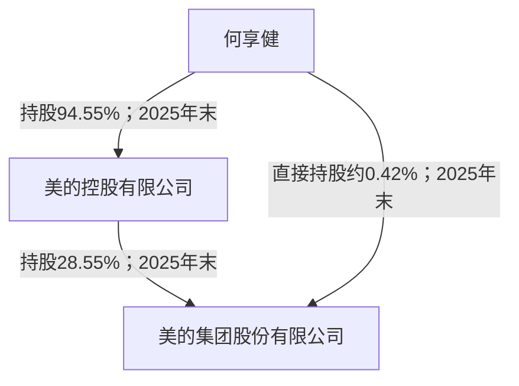

# 美的集团关键人物背景与控制关系调查分析报告

**主体：**美的集团股份有限公司（000333.SZ／00300.HK）  
**主要观察期：**2023—2025年度及2026年上半年，人物角色截面截至2026-06-30  
**资料检索截止：**2026-10-17；历史履历追溯至必要的教育、创业和早期职业阶段  
**性质：**公开资料研究。下文“披露事实”依文件记载；“分析”是据此形成的研究解释。未取得证据的细节不补写。

## 一、调查摘要

美的的人物结构可以从三层理解：何享健及其控制的美的控股提供所有权与控制基础；方洪波及业务高管承担上市公司的经营与组织管理；赵军等同时连接股东单位与上市公司治理。何剑锋是理解家族与产业投资布局的重要人物，其2024年退出上市公司董事会，并不等于何享健丧失控制权，也不能据此写成家族与企业完全脱离。[M23，PDF第77—79页](https://static.cninfo.com.cn/finalpage/2024-03-28/1219429374.PDF#page=77)[M24，PDF第73页](https://static.cninfo.com.cn/finalpage/2025-03-29/1222951181.PDF#page=73)[M25，PDF第118—119页](https://static.cninfo.com.cn/finalpage/2026-03-31/1225065145.PDF#page=118)

本次调查的主要发现：

1. **创始人退休与控制权退出是两件事。** 公司历史材料记载何享健2012年卸任董事长；2025年报仍将其列为实际控制人，2026年中报披露控制主体未变。[M-W1](https://www.midea.com.cn/zh/about-midea/news/news-2020-07-09)[M25，PDF第118—119页](https://static.cninfo.com.cn/finalpage/2026-03-31/1225065145.PDF#page=118)[M26，PDF第92页](https://static.cninfo.com.cn/finalpage/2026-08-29/1225531404.PDF#page=92)
2. **职业经理人体系有具体岗位经历和利益安排支撑。** 方洪波从历史学教育、企业工作进入美的，后经历营销和事业部管理；王建国、管金伟、钟铮等分别有供应链、海外业务、财务审计的长期内部经历。方洪波的长期直接持股与控制家族持股应分别理解。[M-P，PDF第359—361页](https://www1.hkexnews.hk/listedco/listconews/sehk/2024/0909/2024090900006_c.pdf#page=359)[M-P，PDF第367页](https://www1.hkexnews.hk/listedco/listconews/sehk/2024/0909/2024090900006_c.pdf#page=367)[M25，PDF第67—71页](https://static.cninfo.com.cn/finalpage/2026-03-31/1225065145.PDF#page=67)
3. **2024—2026H1正在发生职务与代际调整。** 何剑锋退出董事、赵军进入董事会，高书接任董秘，王建国升任执行总裁，柏林、伏拥军、卫昶先后离开特定高管职务。这些事件能证明岗位更替，尚不足以证明“家族退场”“指定接班人”或管理层冲突。[M24，PDF第73页](https://static.cninfo.com.cn/finalpage/2025-03-29/1222951181.PDF#page=73)[M25，PDF第67—71页](https://static.cninfo.com.cn/finalpage/2026-03-31/1225065145.PDF#page=67)[M26，PDF第60页](https://static.cninfo.com.cn/finalpage/2026-08-29/1225531404.PDF#page=60)
4. **简历字段需要交叉核查。** 方洪波的学位在招股书中有完整年份，不能仅凭2023年报“硕士”、以后年报“博士”推断其最近取得博士学位；赵磊的入职年份则仍存在2011与2018两种披露。[M23，PDF第77—78页](https://static.cninfo.com.cn/finalpage/2024-03-28/1219429374.PDF#page=77)[M-P，PDF第359页](https://www1.hkexnews.hk/listedco/listconews/sehk/2024/0909/2024090900006_c.pdf#page=359)[M-P，PDF第367页](https://www1.hkexnews.hk/listedco/listconews/sehk/2024/0909/2024090900006_c.pdf#page=367)

## 二、范围与对象

### 2.1 重点调查对象

| 层次 | 人物 | 纳入理由与调查重点 |
| --- | --- | --- |
| 控制与家族 | 何享健、何剑锋 | 创业和控制权形成、家族与职业经理人分工、外部产业布局 |
| 经营与股东治理接口 | 方洪波、赵军、王建国 | 董事长兼总裁、控股股东代表性接口、执行总裁角色形成 |
| 产业与财务核心 | 顾炎民、钟铮、管金伟 | 海外与机器人治理、财务审计体系、楼宇科技经营 |
| 功能与业务高管 | 赵磊、张小懿、李国林、王金亮、赵文心、高书 | 产品业务、数字化、质量供应链、品牌、人力、资本市场背景 |
| 期间离任人员 | 胡自强、江鹏、柏林、伏拥军、卫昶 | 历史专业能力、岗位退出及团队结构变化 |

董事、监事和高级管理人员的正式身份分别处理。许定波、肖耿、刘俏、邱锂力、张添等治理成员在相关章节补充，不将独立董事等同于经营高管。主体名单依据四期任职披露及招股书整理。[M23，PDF第75—79页](https://static.cninfo.com.cn/finalpage/2024-03-28/1219429374.PDF#page=75)[M24，PDF第73—76页](https://static.cninfo.com.cn/finalpage/2025-03-29/1222951181.PDF#page=73)[M25，PDF第67—71页](https://static.cninfo.com.cn/finalpage/2026-03-31/1225065145.PDF#page=67)[M26，PDF第60页](https://static.cninfo.com.cn/finalpage/2026-08-29/1225531404.PDF#page=60)

### 2.2 四期人物与控制截面

| 事项 | 2023年末 | 2024年末 | 2025年末 | 2026年6月末 |
| --- | --- | --- | --- | --- |
| 实际控制人 | 何享健 | 何享健 | 何享健 | 未发生变更 |
| 方洪波 | 董事长、总裁 | 同前 | 同前 | 未见中报披露该职务变化 |
| 何剑锋 | 上市公司董事 | 2024-07-02任满离任 | 不列为在任董事 | 不列为在任董事 |
| 赵军 | 监事、美的控股执行总裁 | 2024-07-02转任董事 | 非执行董事 | 未见中报披露该职务变化 |
| 王建国 | 董事、副总裁 | 董事、副总裁 | 2025-09-24起执行总裁 | 承接上述已披露任职 |
| 董秘 | 江鹏 | 江鹏 | 高书，2025-03-28接任 | 未见中报披露该职务变化 |
| 卫昶 | CTO，年末加任副总裁 | 副总裁、CTO | 副总裁、CTO | 2026-05-29离任两项职务 |

表中“未见中报披露变化”表示以前期正式任职与本期变动表衔接，不能替代一份逐人重新公布的期末名册。2024年报部分“现任”简历已经包含2025年3月事件，已按生效日期还原，未将其回填到2024年末。[M23，PDF第75—79页](https://static.cninfo.com.cn/finalpage/2024-03-28/1219429374.PDF#page=75)[M24，PDF第73页](https://static.cninfo.com.cn/finalpage/2025-03-29/1222951181.PDF#page=73)[M25，PDF第67—71页](https://static.cninfo.com.cn/finalpage/2026-03-31/1225065145.PDF#page=67)[M26，PDF第60页](https://static.cninfo.com.cn/finalpage/2026-08-29/1225531404.PDF#page=60)[M26，PDF第92页](https://static.cninfo.com.cn/finalpage/2026-08-29/1225531404.PDF#page=92)

历史控制身份还逐期核对了2023年报控制章节和2024年报控制章节，不只凭2025年结构倒推此前两期。[M23，PDF第145—146页](https://static.cninfo.com.cn/finalpage/2024-03-28/1219429374.PDF#page=145)[M24，PDF第141—142页](https://static.cninfo.com.cn/finalpage/2025-03-29/1222951181.PDF#page=141)

## 三、何享健：从乡镇工业创业到保留控制基础的创始人

### 3.1 可证实的背景和形成过程

美的官网历史材料将企业起点追溯至1968年北滘的集资生产组织，并记载从家电制造、股份制改革到事业部制和员工持股的制度演变。其中1997年的事业部改造、1999年的员工持股及2012年的董事长交接，构成理解何享健角色变化的关键节点。这是公司对自身历史的叙述，宜与当期文件区分，而非当成独立第三方对治理效果的认证。[M-W1](https://www.midea.com.cn/zh/about-midea/news/news-2020-07-09)

| 时间 | 已取得的事实 | 对人物调查的意义 |
| --- | --- | --- |
| 1968年 | 美的前身在北滘设立 | 其影响力首先来自创业和组织形成 |
| 1997年 | 官网记载推动事业部制改造 | 从个人经营转向分权组织的历史线索 |
| 1999年 | 官网记载推行员工持股 | 所有权激励与人才制度的历史线索 |
| 2012年8月 | 卸任美的集团董事长，方洪波接任 | 正式经营职务交接 |
| 2025年末 | 年报仍认定为何享健实际控制 | 职务退出未消除股权控制基础 |
| 2026H1 | 中报披露实际控制人未变 | 本期控制身份延续 |

来源：公司历史材料及报告控制章节。[M-W1](https://www.midea.com.cn/zh/about-midea/news/news-2020-07-09)[M25，PDF第118—119页](https://static.cninfo.com.cn/finalpage/2026-03-31/1225065145.PDF#page=118)[M26，PDF第92页](https://static.cninfo.com.cn/finalpage/2026-08-29/1225531404.PDF#page=92)

**教育背景的证据边界。** 第一财经人物报道将其描述为小学毕业；现有控制章节没有展开教育履历。报告将这一信息保留为媒体背景描述，不附会具体学校、毕业时间或专业，更不从学历推断经营能力。[M-W9](https://www.yicai.com/news/100082367.html)

### 3.2 控制链与家庭关系

2025年报控制图显示：何享健持有美的控股94.55%，美的控股持有上市公司28.55%，何享健另直接持有上市公司约0.42%。上述是不同层级的持股比例，不能简单相加为个人经济权益。何享健当期主要职务为美的控股董事长。原控制图已回看PDF。[M25，PDF第118—119页](https://static.cninfo.com.cn/finalpage/2026-03-31/1225065145.PDF#page=118)

何享健与何剑锋的父子关系在2018年华录百纳股权交易公告中有正式披露。该公告证明亲属关系，不代表其中针对另一上市公司的协议自动适用于美的集团，也不证明何剑锋已经承继何享健的实际控制人身份。[M-W7](https://static.cninfo.com.cn/finalpage/2018-03-21/1204502192.PDF)

### 3.3 分析：制度安排可以观察，私人干预程度无法量化

从其保留控制股权、职业经理人出任董事长及家族成员在控股平台任职，可形成“控制基础保留、经营职务授权”的解释。这个解释比仅称“彻底退休”更符合文件。何享健对职业经理人体系的作用也不只体现在一次人事选择，而体现在较早的事业部制与激励制度安排。

不过，现有公开材料不能证明每一项战略决策中其实际参与程度，也不能证明创始人与经理人之间完全没有非正式沟通。官网关于充分授权的表达属于公司叙事；研究应观察董事会结构、管理层任免和交易审批，而不把宣传性表述直接等同于每天的运作实况。

## 四、方洪波：从人文教育、营销经历到经营决策核心

### 4.1 教育与职业时间线

招股书提供了比年度简历更完整的教育信息：1987年华东师范大学历史学学士、2002年新加坡国立大学工商管理硕士、2009年南京大学企业管理博士。华东师大历史系官网亦将其列为系友；新加坡国立大学中文EMBA项目页面将其列为第7班学员。这里的学校来源是教育关联的交叉证据，学位的具体年份以招股书披露为依据，未进行学位证书认证。[M-P，PDF第359页](https://www1.hkexnews.hk/listedco/listconews/sehk/2024/0909/2024090900006_c.pdf#page=359)[M-W2](https://history.ecnu.edu.cn/cc/5b/c33465a379995/page.htm)[M-W3](https://www.nusembanews.com/?p=18370)

| 时段 | 事实与证据 | 解释边界 |
| --- | --- | --- |
| 1987年 | 取得历史学学士 | 不能从专业直接推断其管理风格 |
| 1987—1992年 | 2002年人物采访记载就职东风汽车 | 历史采访来源，未取得原任职档案 |
| 1992年11月 | 加入美的 | 招股书给出具体月份 |
| 此后 | 历任空调事业部总经理、制冷家电集团总裁、美的电器董事长兼总裁 | 业务经历逐步扩展，未将未核准的每次晋升年份填满 |
| 2012年8月 | 接任集团董事长 | 与创始人交接相联系 |
| 2023—2026H1 | 董事长兼总裁 | 所有者身份与经营角色并存但不相等 |

来源：招股书、历史采访、公司材料和本期年报。[M-P，PDF第359页](https://www1.hkexnews.hk/listedco/listconews/sehk/2024/0909/2024090900006_c.pdf#page=359)[M-W4](https://finance.sina.com.cn/o/20021119/2110280314.shtml)[M-W1](https://www.midea.com.cn/zh/about-midea/news/news-2020-07-09)[M25，PDF第69页](https://static.cninfo.com.cn/finalpage/2026-03-31/1225065145.PDF#page=69)[M26，PDF第60页](https://static.cninfo.com.cn/finalpage/2026-08-29/1225531404.PDF#page=60)

关于其早期从编辑、宣传工作进入市场和业务管理的路径，EMBA项目人物文章有较具体叙述，可作为职业转换线索；本文只将其概括为从企业文字/传播工作向营销和经营扩展，不将文章对其个人品格和经营成就的赞誉写成独立核验结论。[M-W3](https://www.nusembanews.com/?p=18370)

### 4.2 股权利益与经营权

四个研究时点，境内表披露方洪波直接持股均为116,990,492股；披露比例依次为1.67%、1.53%、1.54%、1.54%。这说明“比例变化”不能直接解释为其在2024年卖出、2025年买入：股数并未随比例变化。2026年中报将其中87,742,869股列为有限售条件股份、29,247,623股为无限售条件股份。[M23，PDF第144页](https://static.cninfo.com.cn/finalpage/2024-03-28/1219429374.PDF#page=144)[M24，PDF第139页](https://static.cninfo.com.cn/finalpage/2025-03-29/1222951181.PDF#page=139)[M25，PDF第116页](https://static.cninfo.com.cn/finalpage/2026-03-31/1225065145.PDF#page=116)[M26，PDF第89页](https://static.cninfo.com.cn/finalpage/2026-08-29/1225531404.PDF#page=89)

2026H1的前十名无限售表未列方洪波，不代表其清仓。其总持股仍在前十名普通股股东表中，只有其中的无限售部分参与另一张表的排序。这是人物利益调查中必须跨表核对的例子。[M26，PDF第89—90页](https://static.cninfo.com.cn/finalpage/2026-08-29/1225531404.PDF#page=89)

### 4.3 能力与治理分析

**事实基础：**其长期在空调和制冷业务经营岗位工作，后来承担全集团战略和管理职责；董事长、总裁两项职务合一。香港年报专门解释公司为何采用此安排，属于董事会对治理方式的陈述。[M-P，PDF第359页](https://www1.hkexnews.hk/listedco/listconews/sehk/2024/0909/2024090900006_c.pdf#page=359)[MH24，PDF第93页](https://www1.hkexnews.hk/listedco/listconews/sehk/2025/0424/2025042402399_c.pdf#page=93)

**研究解释：**其作用在于把特定品类经营经历扩展为事业群与集团资源配置能力。历史学教育、后续管理教育与内部晋升构成复合背景，但不能以学位推导其独自实现全部转型成果。王建国、顾炎民、张小懿等的专业分工也表明集团能力依赖团队。

董事长兼总裁能够提高决策衔接，也可能增加监督对独立董事、股东代表及制度执行的依赖。两种解释都需要结合具体议案、考核和任免来观察；不能仅凭一人兼任就断言监督失效，或仅凭公司解释就断言风险已经消除。

### 4.4 公开监管事项及其准确表述

招股书披露方洪波2019年2月因在正式公布业绩预期前，于论坛活动提及2018年预期税前利润而收到广东证监局警示函，并转述公司中国法律顾问对该措施性质的意见。已定位监管局题名为《关于对方洪波采取出具警示函措施的决定〔2019〕12号》的原网页，但本轮正文访问超时；因此事件细节以招股书披露为依据，不声称已逐字核对监管决定全文。[M-P，PDF第359页](https://www1.hkexnews.hk/listedco/listconews/sehk/2024/0909/2024090900006_c.pdf#page=359)[M-W8](https://www.csrc.gov.cn/guangdong/c104548/c1383259/content.shtml)

这是一项与信息披露纪律有关的历史事项，不应改写成刑事处罚。其发生于主要观察期之前，也不能用年报“近三年证券监管处罚不适用”否定更早的监管措施。未开展跨地区、跨法域的穷尽司法背景检索，本报告不提供“无不良记录”证明。

## 五、何剑锋：独立产业投资路径与家族治理接口

2023年报将何剑锋列为本科、上市公司董事，同时任盈峰集团董事长兼总裁；股东单位任职表记载其任美的控股总裁。2024-07-02，其上市公司董事任期届满离任。父子关系由正式交易公告另行确认。[M23，PDF第77—79页](https://static.cninfo.com.cn/finalpage/2024-03-28/1219429374.PDF#page=77)[M24，PDF第73页](https://static.cninfo.com.cn/finalpage/2025-03-29/1222951181.PDF#page=73)[M-W7](https://static.cninfo.com.cn/finalpage/2018-03-21/1204502192.PDF)

盈峰集团官网将自身历史追溯至1994年，以制造及流通起步，后拓展产业和投资业务。该历史帮助解释何剑锋存在上市公司之外的职业与资产平台；不能据此把盈峰全部交易归入美的集团，也不能仅凭父子关系把两家公司视作同一合并主体。其本科院校和专业在本次取得的美的简历中未展开，保留未核实。[M-W5](https://www.infore.com/About)[M23，PDF第77页](https://static.cninfo.com.cn/finalpage/2024-03-28/1219429374.PDF#page=77)

**分析。** 何剑锋的调查价值在于区分家族资产布局与上市公司日常经营。其董事离任是上市公司治理席位变化；何享健控制身份持续、赵军继续连接控股平台与上市公司，则说明不能把这一事件解释为家族完全退出。所谓“拒绝接班”“父子竞争”等叙事缺少本人和正式安排支持，本文不采纳。

**仍需明确的边界。** 当前证据可确认历史职务、亲属关系及其独立产业平台，不能确认未来继承安排、私人资产分配或家族内部决策规则。报告不推断这些未公开事项。

## 六、赵军：财会职业背景连接所有权与董事会

招股书披露赵军1997年取得东北大学秦皇岛分校会计学学士，2008年取得香港中文大学会计学硕士，2013年取得中欧国际工商学院工商管理硕士，并具有注册会计师资格。其2000年3月加入集团，曾在美的电器承担财务会计职责；此后转向美的控股及相关平台。[M-P，PDF第359—360页](https://www1.hkexnews.hk/listedco/listconews/sehk/2024/0909/2024090900006_c.pdf#page=359)

其2023年身份为上市公司监事、美的控股执行总裁，2024年7月转任上市公司董事。2025年报将其列为非执行董事，同时任美的控股执行总裁、美的置业非执行董事；这些角色并不意味着美的置业属于美的集团的合并范围。[M23，PDF第78—79页](https://static.cninfo.com.cn/finalpage/2024-03-28/1219429374.PDF#page=78)[M24，PDF第73页](https://static.cninfo.com.cn/finalpage/2025-03-29/1222951181.PDF#page=73)[M25，PDF第69—72页](https://static.cninfo.com.cn/finalpage/2026-03-31/1225065145.PDF#page=69)

**分析。** 财务出身、控股平台长期任职及非执行董事身份，使其成为研究股东监督、资产边界和关联交易审议的重要接口。与方洪波的区别在于权力来源和岗位职责：一方主要代表控股平台治理接口，一方负责集团整体经营。现有文件不能证明赵军独立控制上市公司，也没有依据将其与何家认定为亲属。

## 七、王建国、顾炎民、钟铮与管金伟：经营体系的四种能力来源

### 7.1 王建国：从会计教育、供应链和事业部管理到执行总裁

其1999年取得郑州轻工业大学会计学学士，同年7月加入美的；2008年取得中欧EMBA。职业经历包含家用空调供应链、行政与人力资源、冰箱业务，后来承担智能家居及海外业务。2025-09-24起任执行总裁，2025年报并披露新能源事业部、万东医疗等相关职责。[M-P，PDF第360页](https://www1.hkexnews.hk/listedco/listconews/sehk/2024/0909/2024090900006_c.pdf#page=360)[M25，PDF第67—69页](https://static.cninfo.com.cn/finalpage/2026-03-31/1225065145.PDF#page=67)

这一路径说明，其内部经验覆盖成本、组织和业务经营，不能因本科为会计就将其视为纯财务高管。执行总裁任命表明管理责任进一步扩大；在没有正式接班声明前，不能写成已确定接任董事长或全面替代方洪波。

可观察的问题是集团层面如何分配方洪波与王建国的职责，以及跨医疗、新能源等业务的管理资源如何配置。需要对应正式职责和事件，而非仅以年龄与职称推测权力排序。

### 7.2 顾炎民：社会学训练、海外战略和跨国子公司治理

招股书记载其1983年杭州大学毕业、1998年取得康奈尔大学社会学博士，2000年6月加入美的；长期在企划投资、海外战略、市场拓展和机器人业务任职。2017年库卡原始公告确认其出任当时KUKA AG监事会主席，与年报所载跨国治理职责相互印证。[M-P，PDF第360页](https://www1.hkexnews.hk/listedco/listconews/sehk/2024/0909/2024090900006_c.pdf#page=360)[M-K1](https://www.kuka.com/-/media/kuka-corporate/documents/press/news/2017/02/20170214_changes_supervisory_board.pdf)[M25，PDF第69页](https://static.cninfo.com.cn/finalpage/2026-03-31/1225065145.PDF#page=69)

**分析。** 其价值并非“机器人博士”的技术标签，而是组织、投资与国际经营经历。社会学博士不能改写成机械或机器人博士。研究其能力应看跨国治理、业务整合及职责连续性；具体技术突破则须归于相应研发团队和技术证据。

库卡现行官网同时列有不同法律实体的监督机构及Eric Wang、Andy Gu等角色。本文以2017公告及本期报告确认的具体实体/日期为依据，不将不同法人机构的“主席”混为同一个岗位，也不从当前网页倒推历史任职。[M-K2](https://www.kuka.com/en-de/company/about-kuka/management/supervisory-board)

### 7.3 钟铮：内部财务、审计到CFO的专业路径

招股书披露其2002年取得哈尔滨工业大学会计学学士、同年7月加入集团，2015年取得南京大学工商管理硕士。此前任金融中心、部品业务财务负责人及集团审计总监；本期任副总裁、首席财务官兼财务总监。[M-P，PDF第367页](https://www1.hkexnews.hk/listedco/listconews/sehk/2024/0909/2024090900006_c.pdf#page=367)[M25，PDF第68—71页](https://static.cninfo.com.cn/finalpage/2026-03-31/1225065145.PDF#page=68)

其经历既包含财务核算和资金相关岗位，又有业务财务与内部审计。**分析：**这有利于理解集团从资金、业务预算到风险控制的衔接，但并不证明会计估计、并购判断或所有内部控制均正确。报告不把其个人职务等同于外部审计责任，也不从持股较少推断其治理影响较低。

2025年任职表披露其直接持有276,152股，属于个人已披露持股；其可能涉及的其他集团或子公司权益须另按具体披露识别，不能用CFO身份推算所有平台权益。[M25，PDF第67—68页](https://static.cninfo.com.cn/finalpage/2026-03-31/1225065145.PDF#page=67)

### 7.4 管金伟：工程教育与海外销售进入楼宇科技经营

其2002年取得昆明理工大学机械工程与自动化学士，同年7月加入集团，后取得南京大学MBA和北京大学EMBA。经历涵盖中央空调海外营销、东盟区域业务，2021年任副总裁，2024年7月进入董事会。[M-P，PDF第361页](https://www1.hkexnews.hk/listedco/listconews/sehk/2024/0909/2024090900006_c.pdf#page=361)[M25，PDF第67—70页](https://static.cninfo.com.cn/finalpage/2026-03-31/1225065145.PDF#page=67)

**分析。** 工程教育、海外经营和中央空调业务的组合，与楼宇科技的技术销售、项目交付及区域经营相匹配。2024年进入董事会增加了其治理层参与，但不表示楼宇业务获得独立控制权。该案例也说明美的高管背景是“专业训练＋长期内部业务历练”的组合，不能一概写成只重营销或只靠外部空降。

## 八、其他高管与期间离任人员

以下为背景与职责摘要；重要变动和研究限制保留。任职表与简历均以各期PDF为证据，未披露院校不补写。

| 人物 | 教育及早期经历 | 本期主要角色、变化与调查分析 | 证据 |
| --- | --- | --- | --- |
| 赵磊 | 西安理工大学国际经贸学士（2006）、企业管理硕士（2011） | 从终端零售、洗衣机经营到空调及智能家居管理；2025年任智能家居事业群总裁。2023年报称2011年加入，招股书和后续年报称2018年，未擅自解释为首次入职/重返 | [M-P，PDF第367页](https://www1.hkexnews.hk/listedco/listconews/sehk/2024/0909/2024090900006_c.pdf#page=367)[M23，PDF第78页](https://static.cninfo.com.cn/finalpage/2024-03-28/1219429374.PDF#page=78)[M25，PDF第71页](https://static.cninfo.com.cn/finalpage/2026-03-31/1225065145.PDF#page=71) |
| 张小懿 | 南京航空航天大学机械制造学士（1993）、威尔士大学新港学院MBA（2007）；曾任职戴尔、联想 | 2010年加入，从海外IT、供应链系统至CDO；是外部IT经验融入内部流程的一条路径，不能仅凭系统上线认定数字化收益 | [M-P，PDF第367页](https://www1.hkexnews.hk/listedco/listconews/sehk/2024/0909/2024090900006_c.pdf#page=367)[M25，PDF第71页](https://static.cninfo.com.cn/finalpage/2026-03-31/1225065145.PDF#page=71) |
| 李国林 | 湘潭工学院暖通学士（1998）、西安交大工程硕士（2006）、北大EMBA（2007） | 1998年加入；空调、生活电器至质量、供应链和可持续发展职责，提供业务与运营约束接口 | [M-P，PDF第367页](https://www1.hkexnews.hk/listedco/listconews/sehk/2024/0909/2024090900006_c.pdf#page=367)[M25，PDF第71页](https://static.cninfo.com.cn/finalpage/2026-03-31/1225065145.PDF#page=71) |
| 王金亮 | 新加坡国立大学EMBA（2005）；1995年加入 | 长期营销、品牌与公共关系经历；不把品牌传播职责等同于掌握全部渠道决策 | [M-P，PDF第368页](https://www1.hkexnews.hk/listedco/listconews/sehk/2024/0909/2024090900006_c.pdf#page=368)[M25，PDF第71页](https://static.cninfo.com.cn/finalpage/2026-03-31/1225065145.PDF#page=71) |
| 赵文心 | 延边大学德语学士（2004）、明尼苏达大学卡尔森管理学院MBA（2015） | 海外营销及美的国际经历后承担首席人才官；2025-03-28加任副总裁。不能把2025任命回填2024年末 | [M-P，PDF第368页](https://www1.hkexnews.hk/listedco/listconews/sehk/2024/0909/2024090900006_c.pdf#page=368)[M25，PDF第68—71页](https://static.cninfo.com.cn/finalpage/2026-03-31/1225065145.PDF#page=68) |
| 高书 | 年报披露博士，具体授予院校/年份未核实；原中金投行执行总经理、董事总经理 | 2025年加入并于3月28日任董秘，职责涵盖联席公司秘书及投资者关系；资本市场经验有据，参与过哪些具体项目仍需项目原始文件 | [M25，PDF第69—71页](https://static.cninfo.com.cn/finalpage/2026-03-31/1225065145.PDF#page=69) |
| 江鹏 | 山西财经大学投资经济管理学士（1997）、香港中文大学会计学硕士（2015）；曾任星湖科技董秘 | 2007年加入，2013年起承担集团董秘及IR；2025-03-28离任该职。离任董秘不能推断为完全离开集团 | [M-P，PDF第368页](https://www1.hkexnews.hk/listedco/listconews/sehk/2024/0909/2024090900006_c.pdf#page=368)[M25，PDF第68—69页](https://static.cninfo.com.cn/finalpage/2026-03-31/1225065145.PDF#page=68) |
| 柏林 | 华中科技大学国际经贸学士（2003） | 从亚太、冰箱国内外营销至中国区经营，2025-10-29因工作安排变动离任副总裁；2025年报学历为硕士，新增学位信息未展开 | [M-P，PDF第367页](https://www1.hkexnews.hk/listedco/listconews/sehk/2024/0909/2024090900006_c.pdf#page=367)[M25，PDF第68—69页](https://static.cninfo.com.cn/finalpage/2026-03-31/1225065145.PDF#page=68) |
| 伏拥军 | 华中科技大学工程学士（1991）、清华EMBA（2010）；曾在东芝万家乐生产岗位工作 | 1999年加入，部品/机电及工业技术背景；2025年先离任董事、后于12月26日离任副总裁，须区分两次变化及原因 | [M-P，PDF第360页](https://www1.hkexnews.hk/listedco/listconews/sehk/2024/0909/2024090900006_c.pdf#page=360)[M25，PDF第68—69页](https://static.cninfo.com.cn/finalpage/2026-03-31/1225065145.PDF#page=68) |
| 卫昶 | 复旦化学学士（1984）、理学博士（1990）；GE及2014—2022年北京低碳清洁能源研究院经历 | 2022年加入，技术战略背景明确；2026-05-29因个人原因离任副总裁及CTO，后继安排未从中报取得明确说明 | [M-P，PDF第368页](https://www1.hkexnews.hk/listedco/listconews/sehk/2024/0909/2024090900006_c.pdf#page=368)[M26，PDF第60页](https://static.cninfo.com.cn/finalpage/2026-08-29/1225531404.PDF#page=60) |
| 胡自强 | 博士；曾任职GE、三星及小天鹅 | 2023年任副总裁并任万东医疗董事长；2024-07-02副总裁任满离任。具体学位院校和后续全部外部任职未核实 | [M23，PDF第78页](https://static.cninfo.com.cn/finalpage/2024-03-28/1219429374.PDF#page=78)[M24，PDF第73页](https://static.cninfo.com.cn/finalpage/2025-03-29/1222951181.PDF#page=73) |

**团队分析。** 内部培养与外部专业输入同时存在：财务、家电业务经理长期在集团轮岗，IT、技术与投行人员带来跨组织经验。不能据同校、同一前雇主或同一时期任职推断私人派系。核心岗位变动较多，需要持续看职责交接和人才制度执行；仅凭变动数量无法确认组织失稳。

## 九、监督、关系与关键事件

### 9.1 已确认关系

| 关系 | 可证实含义 | 不支持的推论 |
| --- | --- | --- |
| 何享健—何剑锋：父子 | 家族及产业平台研究的基础 | 自动认定继承完成或两人全部资产相同 |
| 何享健—美的控股—上市公司 | 2025年控制图披露的控制链 | 将各层持股比例简单相加 |
| 赵军—美的控股／上市公司董事会 | 股东单位任职和非执行董事的接口 | 认定其为实际控制人或家族亲属 |
| 方洪波—经营团队 | 正式董事长、总裁与业务高管的任职结构 | 所有高管构成一致行动或“私人班底” |
| 顾炎民等—境外子公司治理 | 具体实体中已披露的董事/监事会角色 | 不分法律实体和日期认定同一个“库卡主席” |

依据分别为正式公告、控制图和任职章节。[M-W7](https://static.cninfo.com.cn/finalpage/2018-03-21/1204502192.PDF)[M25，PDF第69—72页](https://static.cninfo.com.cn/finalpage/2026-03-31/1225065145.PDF#page=69)[M25，PDF第119页](https://static.cninfo.com.cn/finalpage/2026-03-31/1225065145.PDF#page=119)[M-K1](https://www.kuka.com/-/media/kuka-corporate/documents/press/news/2017/02/20170214_changes_supervisory_board.pdf)[M-K2](https://www.kuka.com/en-de/company/about-kuka/management/supervisory-board)

### 9.2 董事会监督背景与组织调整

2024年7月独立董事更新后，许定波的财会与商学院背景、肖耿和刘俏的经济金融背景、邱锂力的计算机科研背景，为监督与咨询提供不同专业来源。2025年新增职工代表董事张添，披露为博士、2019年加入，具有热力研究岗位经历；2026年6月邱锂力离任、张娅获选。上述是角色与专业配置，不能仅凭头衔证明独立性或履职有效性。[M24，PDF第73—75页](https://static.cninfo.com.cn/finalpage/2025-03-29/1222951181.PDF#page=73)[M25，PDF第70页](https://static.cninfo.com.cn/finalpage/2026-03-31/1225065145.PDF#page=70)[M26，PDF第60页](https://static.cninfo.com.cn/finalpage/2026-08-29/1225531404.PDF#page=60)

原监事会成员董文涛、任凌艳、梁惠铭也有法律、财务及员工/产权管理背景。2025年5月的离任原因披露为治理架构调整，不应写作个人被问责。董文涛的机械工程和法律教育、知识产权履历，以及任凌艳在控股平台财务的任职，对理解原监督接口有帮助。[M-P，PDF第364—365页](https://www1.hkexnews.hk/listedco/listconews/sehk/2024/0909/2024090900006_c.pdf#page=364)[M25，PDF第69页](https://static.cninfo.com.cn/finalpage/2026-03-31/1225065145.PDF#page=69)

## 十、辅助：持股与前十大流通股东变化

| 主体/口径 | 2023年末 | 2024年末 | 2025年末 | 2026年6月末 |
| --- | ---: | ---: | ---: | ---: |
| 美的控股持股数（股） | 2,169,178,713 | 2,169,178,713 | 2,169,178,713 | 2,169,178,713 |
| 美的控股原文比例 | 30.87% | 28.33% | 28.55% | 28.49% |
| 方洪波总持股数（股） | 116,990,492 | 116,990,492 | 116,990,492 | 116,990,492 |
| 香港中央结算有限公司无限售股份（股） | 1,338,736,023 | 1,113,322,948 | 985,916,970 | 893,478,198 |

来源：四期境内股东章节；原文比例保留，未把不同期分母硬统一。香港中央结算有限公司为深股通名义持有人，HKSCC NOMINEES LIMITED为H股名义持有人，两者不是同一最终投资者。[M23，PDF第144页](https://static.cninfo.com.cn/finalpage/2024-03-28/1219429374.PDF#page=144)[M24，PDF第139—140页](https://static.cninfo.com.cn/finalpage/2025-03-29/1222951181.PDF#page=139)[M25，PDF第116—117页](https://static.cninfo.com.cn/finalpage/2026-03-31/1225065145.PDF#page=116)[M26，PDF第89—90页](https://static.cninfo.com.cn/finalpage/2026-08-29/1225531404.PDF#page=89)

三个区间中，美的控股和方洪波的披露股数均保持不变；比例波动需要结合H股发行、回购注销和其他股本变化解释，不能直接判为其交易。深股通名义席位各段分别减少225,413,075股、127,405,978股、92,438,772股（两期相减计算），反映该席位合并持仓变化，不能分配为某位高管或自然人的行为。

2026H1保险账户进入更靠前位置，而方洪波总持股未变、无限售部分未进该表前十。研究上更值得强调的是控制基础与管理层个人持股稳定、外部名义与机构持仓发生变化；这些变化不足以证明控制权转移。[M26，PDF第89—90页](https://static.cninfo.com.cn/finalpage/2026-08-29/1225531404.PDF#page=89)

## 十一、综合判断与未决问题

### 11.1 有证据支持的判断

- **控制基础与经营岗位分工较清晰，但并非毫无交叉。** 股权链在何享健，经营核心在方洪波，赵军等提供股东治理接口；管理层自身持股形成额外经济利益联系。
- **高管能力来源具有多样性。** 内部事业部轮岗、财务审计、海外经营、跨国IT和研发机构经历能够对应具体职责。学历只是背景，岗位和实际事件更适合解释组织作用。
- **接班是持续过程。** 2024—2026H1的董事与高管调整显示岗位更新；王建国升任执行总裁具有重要性，但现有证据不支持写成方洪波已经交棒。
- **治理分析需要穿过宣传叙事。** 长期授权、专业管理等公司主张，可与控制链、任职和激励事实相互印证；具体监督是否有效仍应看议案与交易。

### 11.2 未决事项与具体限制

| 问题 | 已掌握证据 | 尚未解决的部分 |
| --- | --- | --- |
| 赵磊入职年2011／2018 | 2023年报、2024招股书及以后年报原文 | 是否存在重返、组织边界变化或披露差错，不能自行解释 |
| 方洪波学历字段 | 招股书披露1987／2002／2009三学位 | 未取得校方学位认证；2023年报较简略字段不作为最近进修证据 |
| 高书、胡自强等具体教育细节 | 公司简历中的博士等学历 | 授予院校、专业、年份未完整确认 |
| 创始人与家族未来接班安排 | 已披露历史职务与亲属关系 | 非公开资产、私人沟通与未来继承不推断 |
| 卫昶离任后的技术职责安排 | 2026H1变动表 | 未在已取得中报中明确定位继任人 |
| 海外实体治理角色 | 库卡官方历史公告、现行网页 | 现行网页无统一历史生效日；不倒推2026-06-30全部岗位 |
| 监管司法背景 | 年报与招股书、已定位的2019监管网页 | 原决定正文访问超时；非全法域、全时期司法清查 |

2026年6月末之后的新任职没有并入上述期末截面；检索日看到的动态网页仅用于补充背景或明确标注的机构状态，未以其替换历史岗位。

## 十二、来源与方法

本报告依据原始PDF逐页摘录，关键控制图、跨行任职表已回看原页；补充公司历史、学校及原任职/子公司资料。台账见`personnel_research/`中的人物、履历、关系和证据文件。计算仅用于辅助持仓变化，股数单位为股；不涉及币种换算或盈利预测。

<!-- RESEARCH_SOURCE_INDEX_START -->

| 编号 | 来源及日期 | 原件/获取状态 |
| --- | --- | --- |
| M23 | [美的集团股份有限公司2023年年度报告](https://static.cninfo.com.cn/finalpage/2024-03-28/1219429374.PDF)；发行人／官方披露渠道；2024-03-28 | [仓库原件](origin/年度报告/美的2023.pdf)；复用已归档全文；本轮阅读相应人物与控制章节 |
| M24 | [美的集团股份有限公司2024年年度报告](https://static.cninfo.com.cn/finalpage/2025-03-29/1222951181.PDF)；发行人／官方披露渠道；2025-03-29 | [仓库原件](origin/年度报告/美的2024.pdf)；复用已归档全文；本轮阅读相应人物与控制章节 |
| M25 | [美的集团股份有限公司2025年年度报告](https://static.cninfo.com.cn/finalpage/2026-03-31/1225065145.PDF)；发行人／官方披露渠道；2026-03-31 | [仓库原件](origin/年度报告/美的2025.pdf)；复用已归档全文；本轮阅读相应人物与控制章节 |
| M-W1 | [美的的荣与光](https://www.midea.com.cn/zh/about-midea/news/news-2020-07-09)；美的集团官网；2020-07-09 | 官网历史叙述；非独立业绩认证 |
| M26 | [美的集团股份有限公司2026年半年度报告](https://static.cninfo.com.cn/finalpage/2026-08-29/1225531404.PDF)；发行人／官方披露渠道；2026-08-29 | [仓库原件](origin/年度报告/美的2026半年度.pdf)；复用已归档全文；本轮阅读相应人物与控制章节 |
| M-P | [美的集团2024年H股招股章程](https://www1.hkexnews.hk/listedco/listconews/sehk/2024/0909/2024090900006_c.pdf)；美的集团／香港交易所；2024-09-09 | [仓库原件](origin/人物调查/美的_2024H股招股书.pdf)；官方PDF已归档并阅读相应章节 |
| M-W9 | [美的何享健：从乡镇企业改组试验田走出的改革先锋](https://www.yicai.com/news/100082367.html)；第一财经；2018-12-18 | 可靠媒体背景描述；小学学历非独立学籍认证 |
| M-W7 | [华录百纳有关股份转让及一致行动关系公告](https://static.cninfo.com.cn/finalpage/2018-03-21/1204502192.PDF)；发行人／巨潮资讯；2018-03-21 | 官方公告检索内容确认父子关系；未用于推定美的其他一致行动安排 |
| M-W2 | [方洪波：历史学系校友捐资，华东师大设上善基金](https://history.ecnu.edu.cn/cc/5b/c33465a379995/page.htm)；华东师范大学历史学系；2021 | 学校公开材料，确认校友关联 |
| M-W3 | [学员动态：方洪波，中国最成功的职业经理人的100条思考](https://www.nusembanews.com/?p=18370)；新加坡国立大学中文EMBA项目页面；2023-05-31 | 项目人物文章，叙述及评价分开使用 |
| M-W4 | [方洪波：我思故我在](https://finance.sina.com.cn/o/20021119/2110280314.shtml)；《赢》周刊／新浪转载；2002-11-19 | 历史人物采访；早期雇主档案未另获 |
| MH24 | [2024年度報告](https://www1.hkexnews.hk/listedco/listconews/sehk/2025/0424/2025042402399_c.pdf)；发行人／官方披露渠道；2025-04-24 | [仓库原件](origin/H股披露/美的H股2024年报.pdf)；复用已归档全文；本轮阅读相应人物与控制章节 |
| M-W8 | [关于对方洪波采取出具警示函措施的决定〔2019〕12号](https://www.csrc.gov.cn/guangdong/c104548/c1383259/content.shtml)；中国证监会广东监管局；2019 | 官方题名已定位；正文访问超时，事件细节以招股书复核 |
| M-W5 | [关于盈峰／公司历史](https://www.infore.com/About)；盈峰集团官网；页面含截至2025年末资料 | 企业官网自述，未用作美的合并范围依据 |
| M-K1 | [Changes on KUKA Supervisory Board](https://www.kuka.com/-/media/kuka-corporate/documents/press/news/2017/02/20170214_changes_supervisory_board.pdf)；KUKA；2017-02-14 | 原任职机构官方历史公告 |
| M-K2 | [KUKA Supervisory Board](https://www.kuka.com/en-de/company/about-kuka/management/supervisory-board)；KUKA；动态页面；无统一历史生效日 | 不同法人监督机构分别列示，不倒推历史 |

<!-- RESEARCH_SOURCE_INDEX_END -->

**交接：**本公司报告已形成人物档案、关系与控制链、团队分析及股东变化附录；公开证据不足之处以上表为准。人类研究者可据源文件复核并决定最终提交表述。
